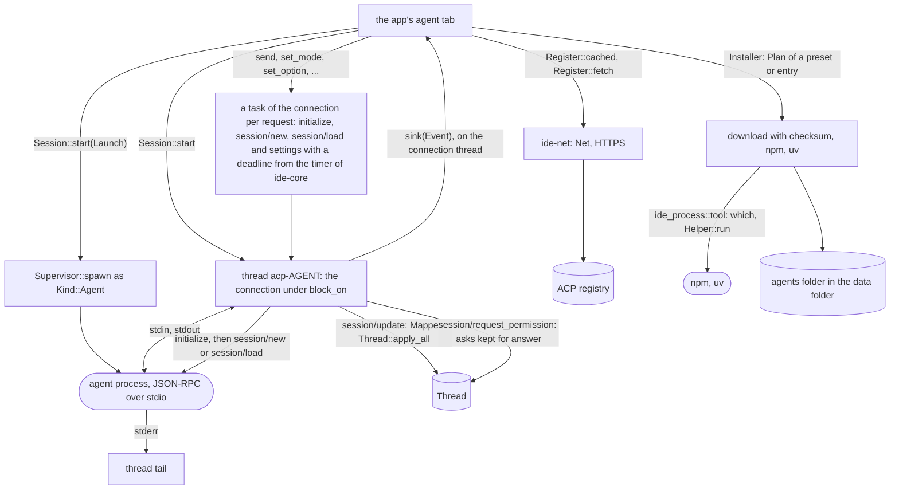

# ide-acp

Agents over the Agent Client Protocol (E4, E5, E19), such as Codex or Gemini CLI: a session that fills the shared thread model (`ide-thread`), the register of agents the app knows, and installing them with pinned versions. The protocol runs through the `agent-client-protocol` crate, whose types stay inside this one; `docs/acp.md` lays down how each update changes a thread.

The API is documented in [`src/lib.rs`](src/lib.rs) and its modules.
