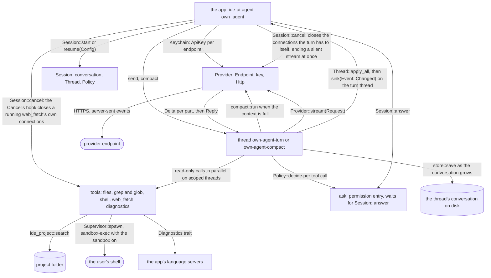

# ide-agent

The app's own agent (E6): one loop for Anthropic, OpenAI, Gemini, OpenRouter, Ollama, LM Studio and servers that speak
OpenAI's or Anthropic's protocol, with keys from the keychain and prices for what it spends. A session fills the
shared thread model (`ide-thread`) and is driven like an ACP session; its tools read, search, edit and write files,
run commands, fetch pages and read the language servers' diagnostics under a policy that decides what runs, asks or
is refused (E27).

The API is documented in [`src/lib.rs`](src/lib.rs) and its modules.
