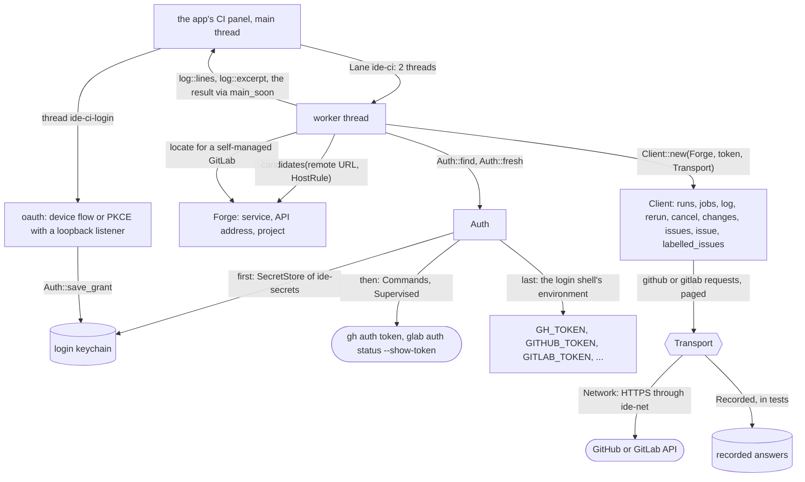

# ide-ci

CI for the app (E12): GitHub Actions and GitLab CI of a repository's remote, on github.com, gitlab.com, GitHub
Enterprise Server and self-managed GitLab. It works out which service a remote belongs to, finds a token strictly per
host, and reads, re-runs, starts and cancels runs and jobs, reads their logs and lists open merge requests and issues,
and reads an issue's text and labels, never its comments, for the Leitstand's intake (E176).
Every call blocks until the network answers, so the app runs it on a worker thread, and only for trusted folders
(E22). The module `panel` is what the CI panel decides without a window (E98): its phase, rows and when it reads
again.

The API is documented in [`src/lib.rs`](src/lib.rs) and its modules.
