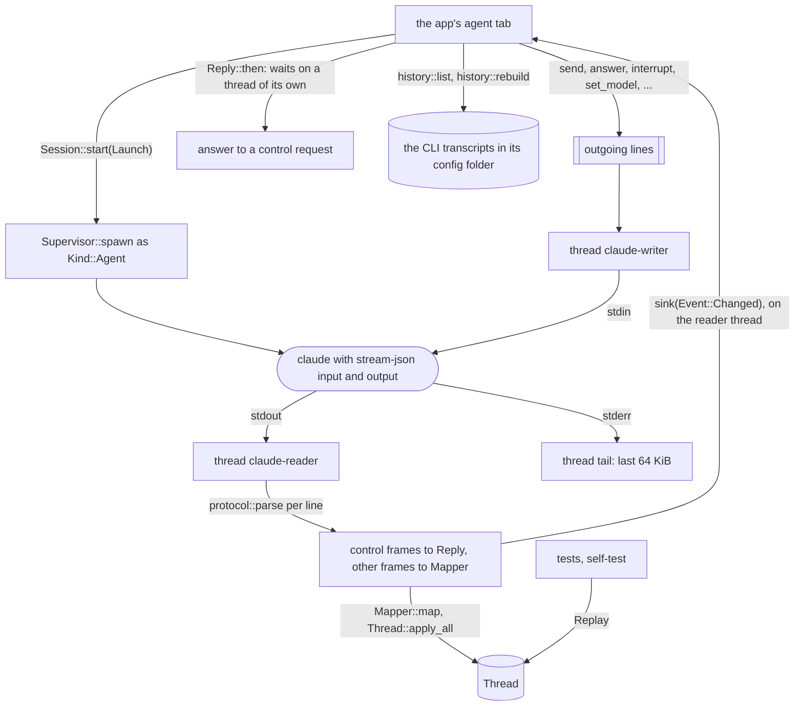

# ide-claude

The Claude connection (E21): the installed `claude` CLI in stream-json mode, one JSON frame per line each way. Frames
are read leniently and mapped into the shared thread model (`ide-thread`); control requests in both directions
carry permissions, plan approvals, questions, model and mode changes. `docs/claude-mapping.md` lays down how each
frame changes the thread. Past sessions are read from the CLI's own transcripts, and a recording can be replayed
without a process.

The API is documented in [`src/lib.rs`](src/lib.rs) and its modules.
