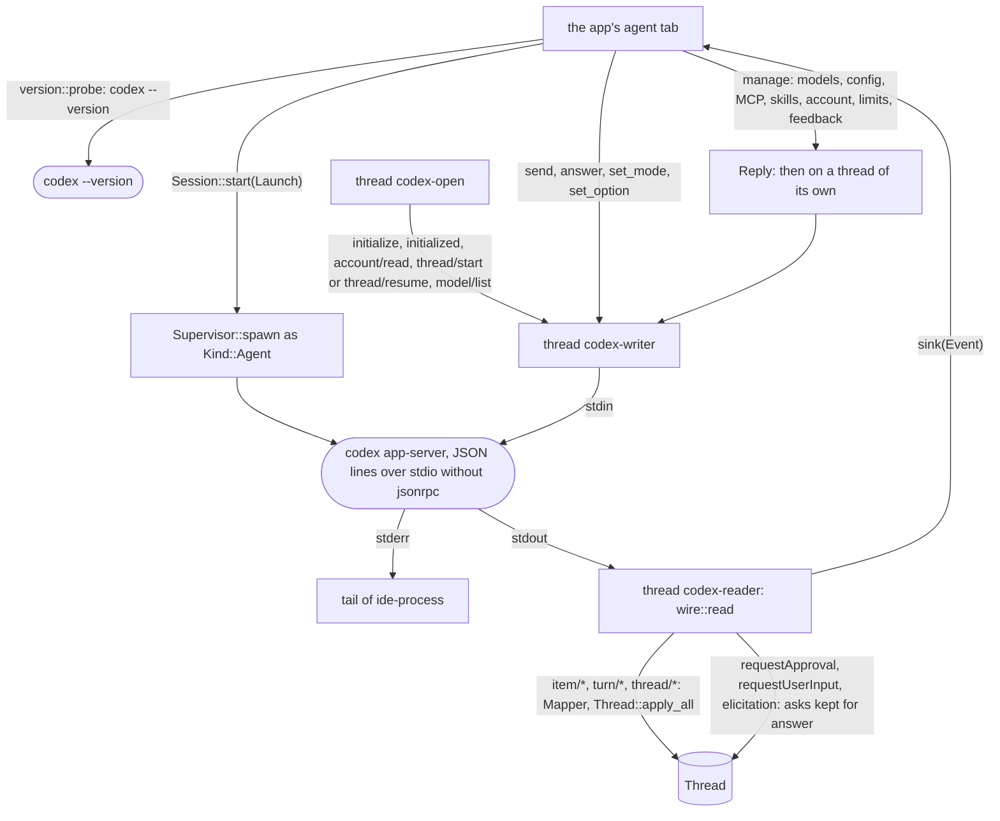

# ide-codex

OpenAI Codex over its own app-server protocol (E147, "SDK first, ACP as fallback"): `codex app-server` on stdio, a session that fills the shared thread model (`ide-thread`) as an ACP session does, and the management calls Codex offers beyond ACP. An older Codex is refused, so the app takes `codex-acp` through `ide-acp` instead; `docs/codex.md` lays down the framing, the handshake and how each notification changes a thread.

The API is documented in [`src/lib.rs`](src/lib.rs) and its modules.
