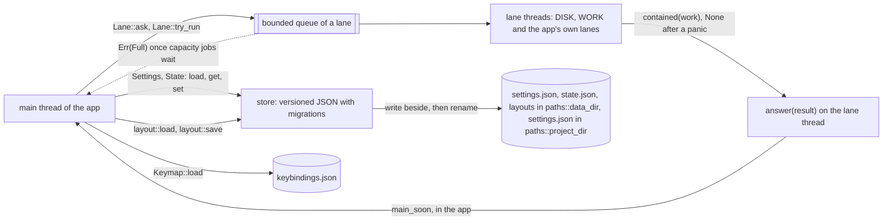

# ide-core

What the app knows and keeps without a window: its data folders, settings in a user and a project layer, the
shortcut table, each project's window tabs, and the lanes that move blocking work off the main thread. Nothing here
starts a process; the only threads are a lane's workers, which start with its first job.

The API is documented in [`src/lib.rs`](src/lib.rs) and its modules.
