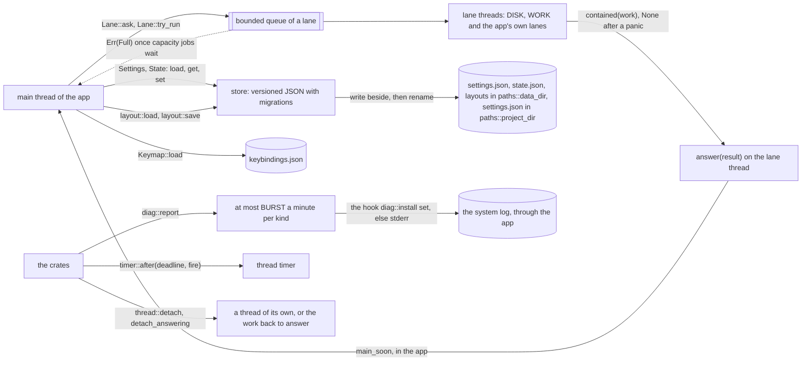

# ide-core

What the app knows and keeps without a window: its data folders, settings in a user and a project layer, the
shortcut table, each project's window tabs, and the lanes that move blocking work off the main thread. It also holds
what every crate shares: locks that survive a panic, a request to cancel, threads started for one piece of work that
hand it back when no thread starts, one timer thread for every deadline, and the diagnostics hook the app installs,
limited to a few reports of a kind per minute. Nothing here starts a process; the only threads are a lane's workers and
the timer, which start with their first job.

The API is documented in [`src/lib.rs`](src/lib.rs) and its modules.
