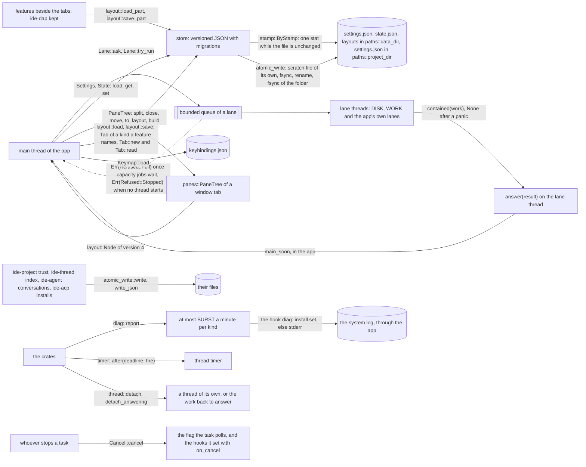

# ide-core

What the app knows and keeps without a window: its data folders, settings in a user and a project layer, the shortcut table, each project's window tabs with the rules of their panes, and the lanes that move blocking work off the main thread. A document of a layout is a kind's name and what the feature of that kind keeps of it; the app's features name their kinds and read them back, and keep parts of their own beside the tabs, such as the debugger its breakpoints. Each setting's key says whether it follows the user to their other Macs, and each crate lists its keys as `SETTINGS`, which the app gathers into one registry for the sync. It also holds what every crate shares: locks that survive a panic, a request to cancel that tasks poll or hook into, threads started for one piece of work that hand it back when no thread starts, one timer thread for every deadline, the diagnostics hook the app installs, limited to a few reports of a kind per minute, files replaced as a whole and flushed to the disk, and answers about a file kept while its stamp stays the same. Nothing here starts a process; the only threads are a lane's workers and the timer, which start with their first job.

The API is documented in [`src/lib.rs`](src/lib.rs) and its modules.
