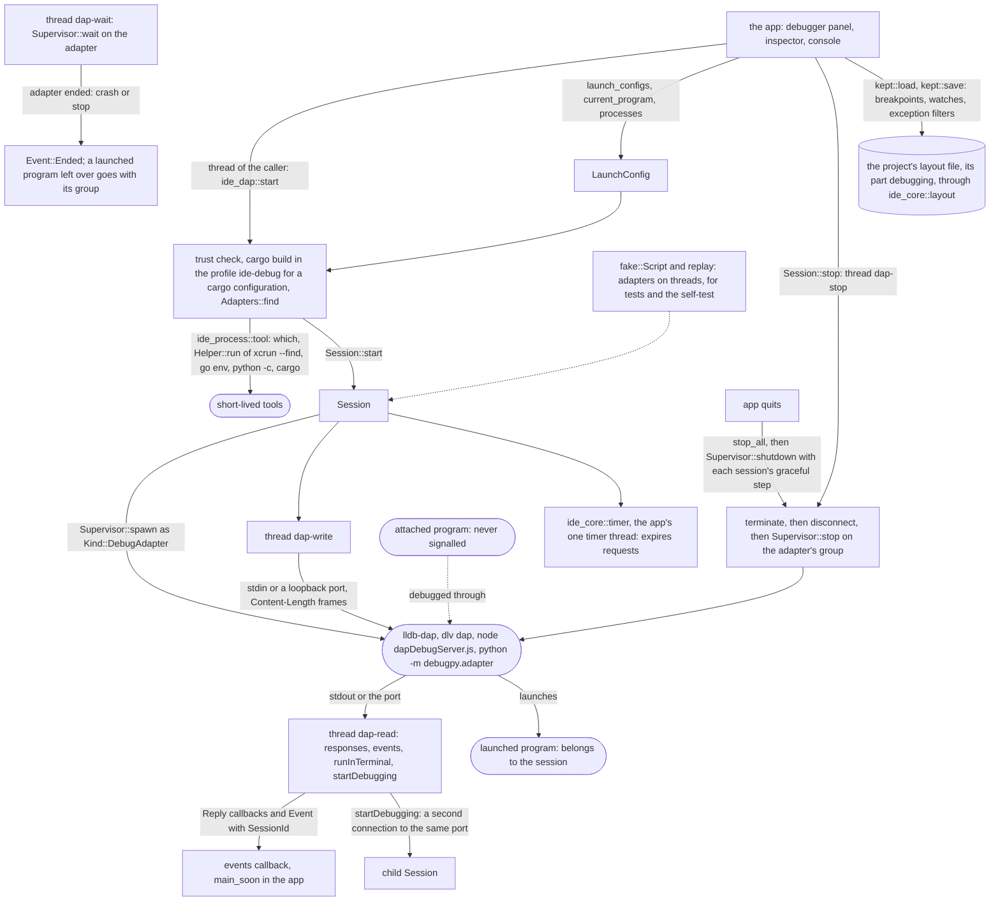

# ide-dap

Debugging through the Debug Adapter Protocol (B1, E93): a session per program with its adapter, the adapters the app
knows (lldb-dap through `xcrun`, Delve, vscode-js-debug pinned and checked, debugpy from the project's Python), launch
configurations from `.vscode/launch.json` or the file in the editor, and who owns which process (Review C7). Like the
language server client it runs on the transport of `ide-rpc` with threads of its own; requests answer through callbacks and events arrive through
one callback with the session's id. Rust programs are built in the Cargo profile `ide-debug`, the dev profile with full
debug information, defined through the environment and built into `target/ide-debug`, so the project's files and its
dev build stay untouched. Nothing runs for a folder the user has not trusted. The module `model` is what the
debugger panel decides without a window (E98): sessions, selection, breakpoints, inspector, console and commands;
`kept` is what a project keeps of it between launches, as a part of its layout file beside the window tabs.

The API is documented in [`src/lib.rs`](src/lib.rs) and its modules.
