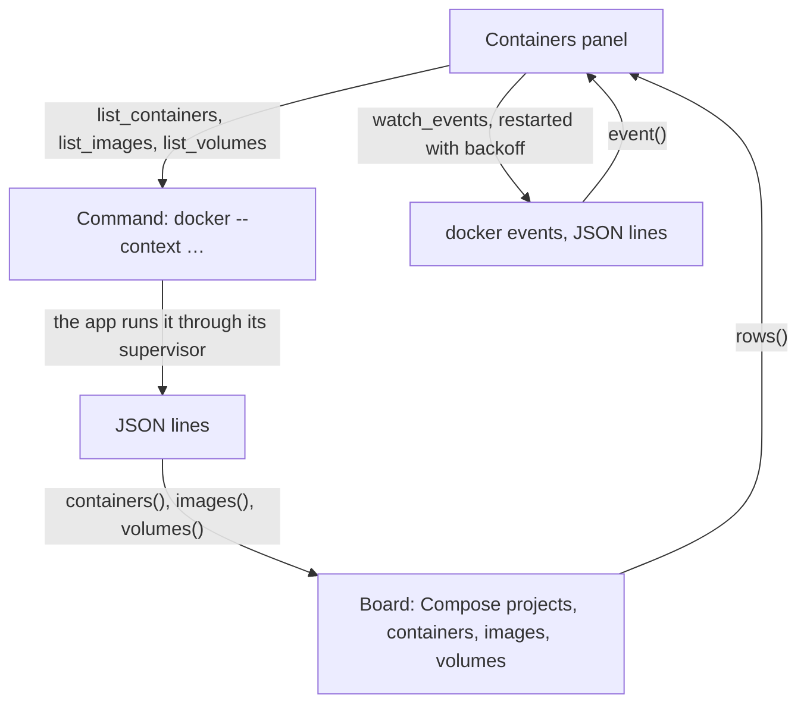

# ide-docker

Managing containers, images, volumes and Compose projects through the `docker` command line (E136), without AppKit and without starting processes. It builds each command's arguments, every one with `--context`, reads what `--format '{{json .}}'` prints one object per line, and models the Containers panel's tree. Compose projects come from the containers' labels and the folder's Compose files, not from `docker compose ls`.

The API is documented in [`src/lib.rs`](src/lib.rs).
