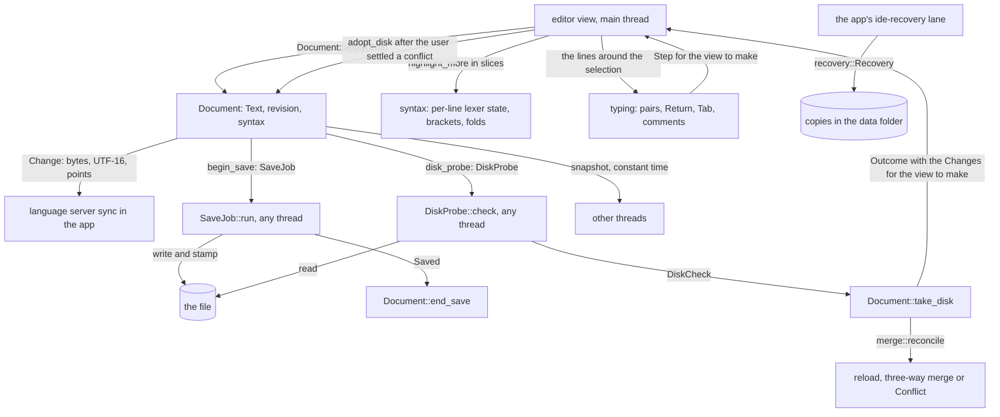

# ide-document

The document model behind every editor: the text of one file shared by the views that show it, each edit in UTF-16
units with what a language server needs to follow it, the file it was read from and is saved to, changes other
programs make to that file, copies against a crash, colours, brackets and folds by lines, and the edits typing help
makes. AppKit keeps the displayed text and its undo; this crate follows it. It starts no threads or processes:
blocking calls are handed to the caller's lanes.

The API is documented in [`src/lib.rs`](src/lib.rs) and its modules.
