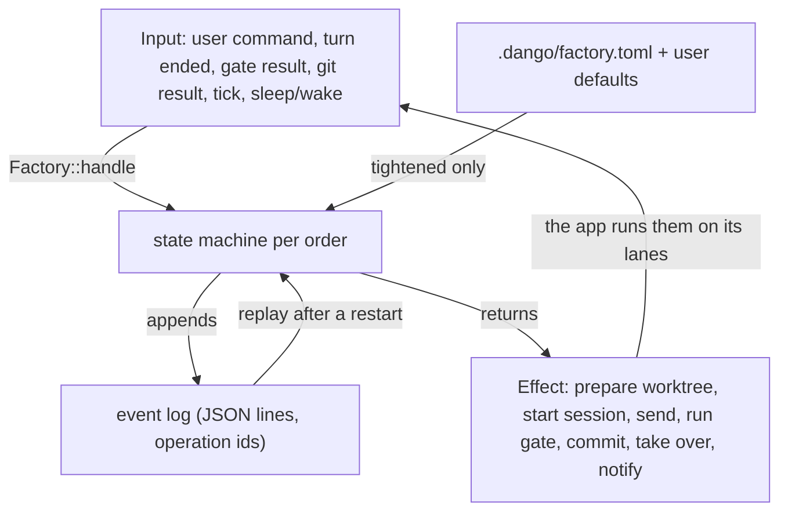

# ide-factory

The Leitstand's orchestrator (docs/phase-13.md): work orders that agents of several vendors build and check in
worktrees of their own. A state machine without AppKit and without an async runtime: the app hands it what happened
and carries out what it asks for, so every rule is testable with a set clock.

The API is documented in [`src/lib.rs`](src/lib.rs).
