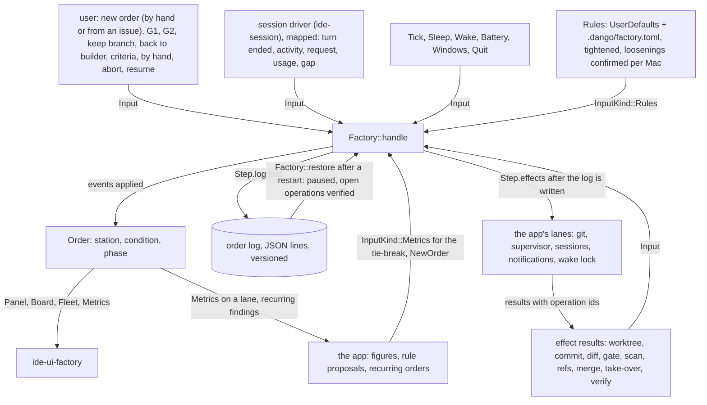

# ide-factory

The Leitstand's orchestrator (docs/phase-13.md, E160): work orders that agents of several vendors build and check in
worktrees of their own. A functional core without AppKit, threads, an async runtime, file or process I/O or clock
reads: the app hands `Factory::handle` what happened, appends the returned log entries to each order's JSON-lines file,
and only then carries out the returned effects on its lanes. Every rule is testable with a set clock.

What the app keeps for the factory: each order's log, the daily account (`DailyAccount`, across projects), the quota
book (`QuotaBook`), the confirmation hashes per project (`Confirmations`), the dates of the recurring orders per
project (`Schedule`) and the user defaults (`UserDefaults`).

The API is documented in [`src/lib.rs`](src/lib.rs) and its modules.
