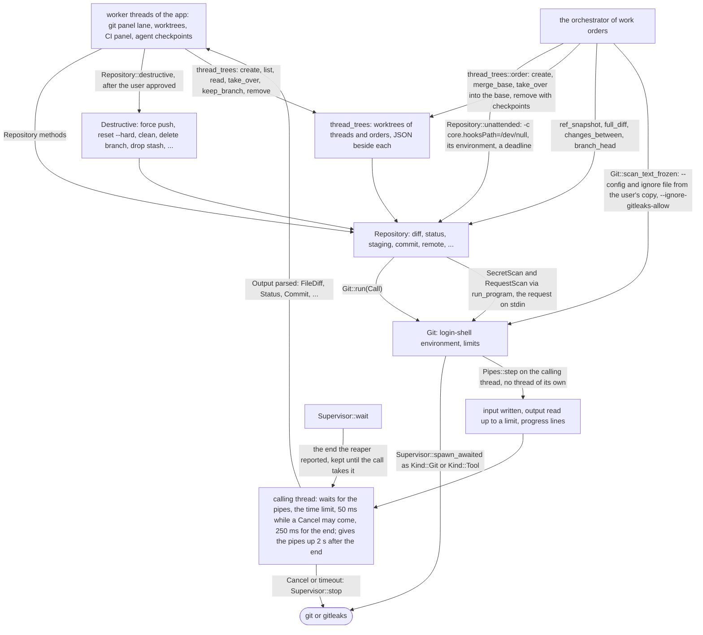

# ide-git

git for the app through the `git` program: repositories, status, diffs, staging down to single hunks, commits,
remotes, branches, history, the stash, worktrees, merge and cherry-pick, checkpoints of a folder before an agent's
turn, a secrets check with gitleaks before commits, and the request for a commit message, which gitleaks reads from
standard input before anything may send it. Every call blocks until its process ends, so callers run it on a worker
thread, and only in folders the user trusts (E22).

`panel` holds what the app's Git panel decides without AppKit (E98): its rows and sections, the commit graph's
lanes, and its words for git's errors; `ThreadTree` and `TreeState` describe the worktree of an AI thread (I1) or a
work order (F50), and `thread_trees` makes, lists, reads, takes over and removes them (F49), so the orchestrator of
work orders, which may not depend on a UI crate (E99), uses the same logic as the Git panel.

For that orchestrator (phase 13) the crate also has git without the repository's hooks, remotes, signing and
editors, with a given environment and a deadline, which finds a worktree only through the shared git folder's records
and names its git folder in every call (`Git::unattended`, `Git::bound_to`, E192); the diff a secrets check reads,
binary files included and the working tree's attributes ignored (`Repository::diff_since_as_text`); snapshots of every ref for the ref watch (`Repository::ref_snapshot`, E173);
the secrets check with rules frozen from the user's working copy (`Git::scan_text_frozen`, C52); a byte-exact diff
between two commits (`Repository::full_diff`, C56), the files changed between them (`changes_between`, C54) and a
branch's head with parents, tree and message (`branch_head`, C66).

The API is documented in [`src/lib.rs`](src/lib.rs) and its modules.
