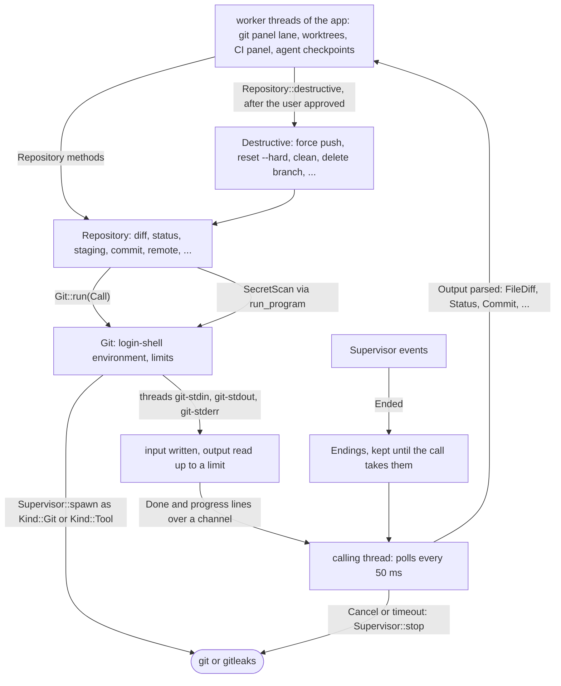

# ide-git

git for the app through the `git` program: repositories, status, diffs, staging down to single hunks, commits,
remotes, branches, history, worktrees, merge and cherry-pick, checkpoints of a folder before an agent's turn, and a
secrets check with gitleaks before commits. Every call blocks until its process ends, so callers run it on a worker
thread, and only in folders the user trusts (E22).

The API is documented in [`src/lib.rs`](src/lib.rs) and its modules.
