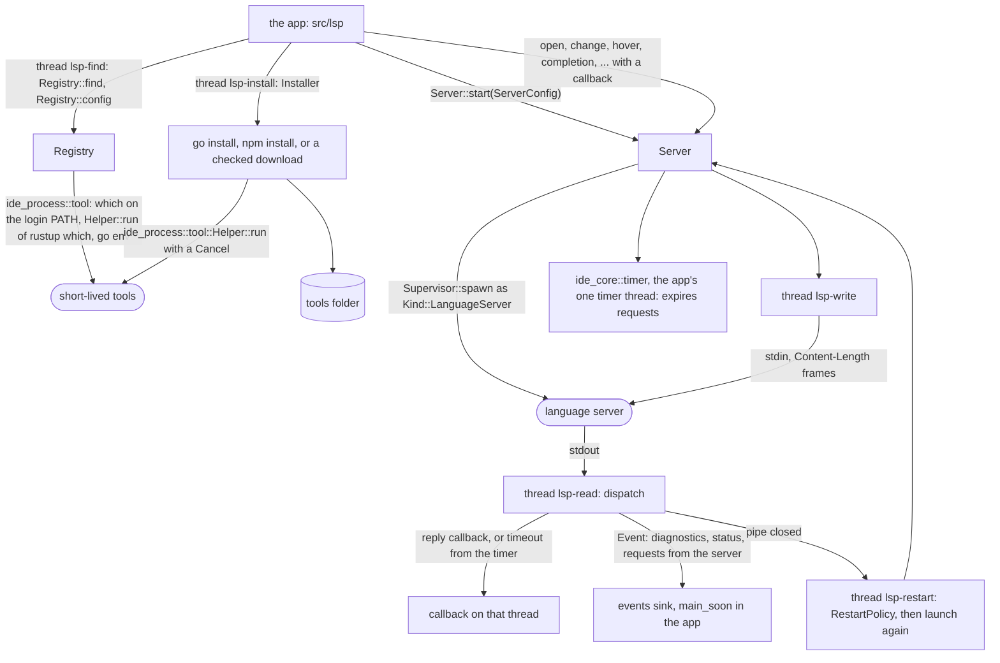

# ide-lsp

Language servers for the editor: the JSON-RPC client, the languages with their servers (Go, Rust, TypeScript, common servers on the PATH and the user's own), finding a project's server and installing a missing one. The client runs on the transport of `ide-rpc` with threads of its own, so no call blocks and no async runtime runs beside AppKit's run loop; every position counts UTF-16 code units whatever the server chose. Servers run only for folders the user trusts.

Window-free parts of the app's language features live here too: `workspace_edit` checks and carries out a server's workspace edit against the folder and the open editors, `offsets` converts between the document model's UTF-16 offsets and protocol positions, `file_watch` matches changed files against the watchers servers registered, and `symbol_search` plans the servers a project-wide symbol search needs and ranks what they found.

The API is documented in [`src/lib.rs`](src/lib.rs) and its modules.
