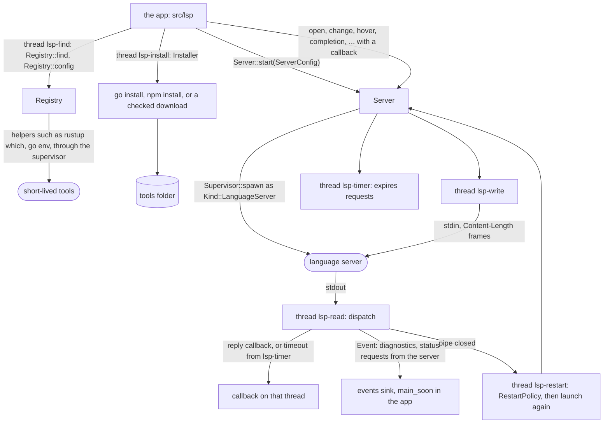

# ide-lsp

Language servers for the editor: the JSON-RPC client, the languages with their servers (Go, Rust, TypeScript, common
servers on the PATH and the user's own), finding a project's server and installing a missing one. The client runs on
threads of its own, so no call blocks and no async runtime runs beside AppKit's run loop; every position counts
UTF-16 code units whatever the server chose. Servers run only for folders the user trusts.

The API is documented in [`src/lib.rs`](src/lib.rs) and its modules.
