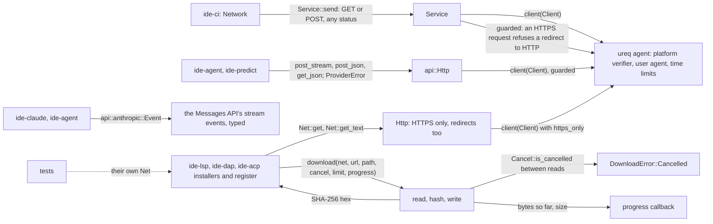

# ide-net

The one way onto the network; no crate besides it names the HTTP library. Every client is HTTPS checked against the
system's certificate store and names the app in its user agent, and a request that starts on HTTPS stays on it through
its redirects; plain HTTP is only for addresses the caller names so, such as a local model server; installers and
registers fetch through the `Net` seam, which tests stand in for; downloads hash what arrives while they report progress
and listen for `Cancel`. The installers of language servers (`ide-lsp`) and debug adapters (`ide-dap`) share their
stages, progress and errors from here; the agent installer (`ide-acp`) shares the download. `api` is the client the own
agent (`ide-agent`) and the local edit predictions (`ide-predict`) reach the providers of language models with, and the
`ProviderError` a failed request becomes; `api::anthropic` types the events of the Messages API's stream for the own
agent and for the Claude Code CLI's partial messages (`ide-claude`).

The API is documented in [`src/lib.rs`](src/lib.rs) and its modules.
