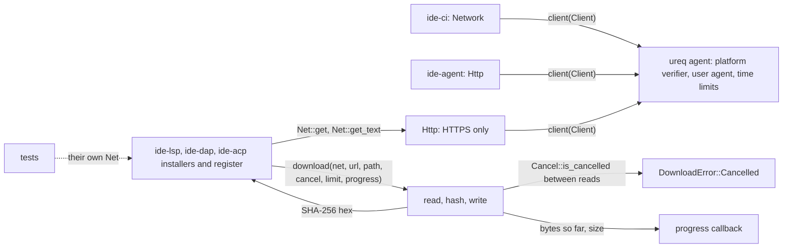

# ide-net

The one way onto the network. Every client is HTTPS checked against the system's certificate store and names the
app in its user agent; installers and registers fetch through the `Net` seam, which tests stand in for; downloads
hash what arrives while they report progress and listen for `Cancel`. The installers of language servers
(`ide-lsp`) and debug adapters (`ide-dap`) share their stages, progress and errors from here; the agent installer
(`ide-acp`) shares the download.

The API is documented in [`src/lib.rs`](src/lib.rs) and its modules.
