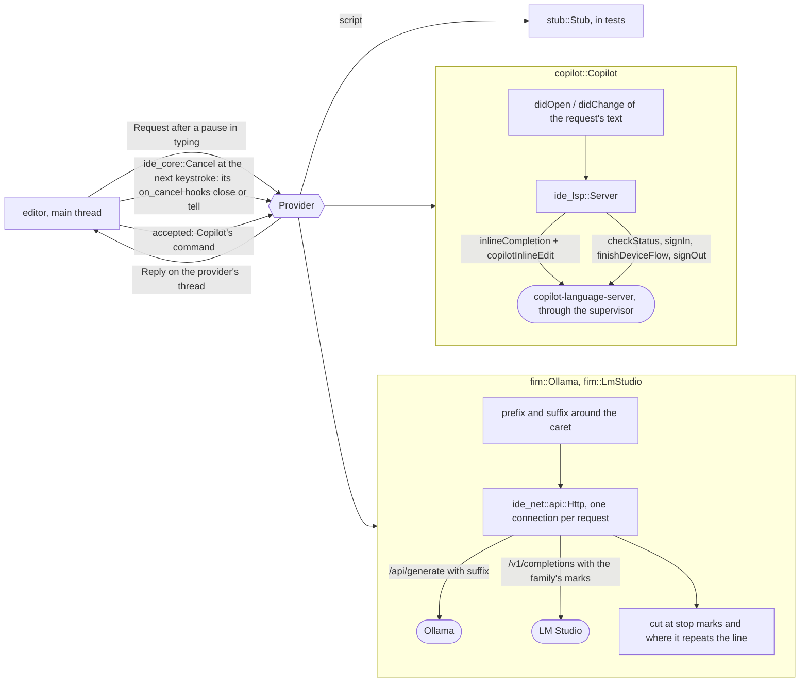

# ide-predict

Edit predictions (B4, E91, E92): what a provider proposes to write next while the user types. The editor asks after a
pause in typing, the provider answers once on a thread of its own, and the editor shows what still fits the document
in grey until Tab takes it. A cancel at the next keystroke really stops the work: Copilot hears `$/cancelRequest`,
and a local server sees its connection close, so it stops generating (R9).

- **Copilot** (`copilot`): the official `@github/copilot-language-server`, installed on request with
  `ide_lsp::Installer` (`copilot::INSTALL`) and found with `copilot::find`, in the tools folder or with
  `ide_process::tool::which` on the login shell's PATH. The provider keeps the server told about
  the documents it asks for, asks for an inline completion and next edits together, and turns their positions into
  byte offsets of the request's text, shrunk to what actually changes. The command an item carries is the
  prediction's feedback and runs through `workspace/executeCommand` once the user took it. Sign-in is GitHub's device
  flow, which the server runs: `sign_in` gives the code and page to show, `finish_sign_in` lets the server open the
  page and asks for the account until it is signed in; `Account` tells signed in, needs sign-in and no subscription
  apart.
- **Local fill-in-the-middle** (`fim`): Ollama through `/api/generate` with `suffix`, using the model's own template;
  LM Studio through `/v1/completions` without a chat template, with the marks and stop sequences of the model's
  family from a fixed list: Qwen2.5 and Qwen3 Coder, StarCoder and StarCoder2, DeepSeek Coder, Code Llama,
  Codestral, CodeGemma. HTTP is the one the agent uses too (`ide_net::api::Http`, Review C16); each request gets a
  client of its own, which cancelling closes.
- Errors: `Error::SignIn`, `Error::Unavailable` with what to do in the interface language, `Error::Malformed`.

The API is documented in [`src/lib.rs`](src/lib.rs). Tests run without the network: a fake Copilot server
(`tests/support/fake_copilot.rs`), recorded answers of Ollama and LM Studio (`tests/fixtures`), and a fuzz target for
the answers (`fuzz/`, `cargo xtask fuzz answer`); the real providers run in `make test-integration`.

`guard` is the secrets check before a request leaves the Mac (R15): a provider outside the Mac is asked only after
gitleaks found nothing in the text of that revision.
