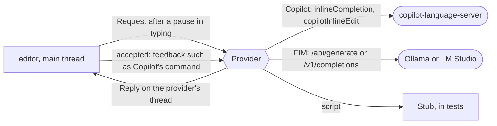

# ide-predict

Edit predictions (B4, E91, E92): what a provider proposes to write next while the user types. The editor asks after a
pause in typing, the provider answers once on a thread of its own, and the editor shows what still fits the document
in grey until Tab takes it. Providers are GitHub Copilot through its language server and fill-in-the-middle models
under Ollama and LM Studio; a scripted stub serves tests.

The API is documented in [`src/lib.rs`](src/lib.rs).
