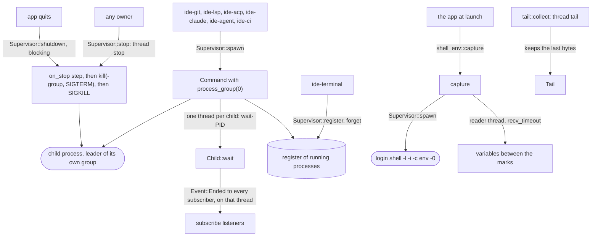

# ide-process

The one register of every process the app starts or adopts: each runs in a process group of its own, is listed for
the activity view, and is ended in order — graceful step, SIGTERM, SIGKILL — when it is stopped or the app quits. It
also reads the login shell's environment, which every other child process is started with, and keeps the tail of a
process's output.

The API is documented in [`src/lib.rs`](src/lib.rs) and its modules.
