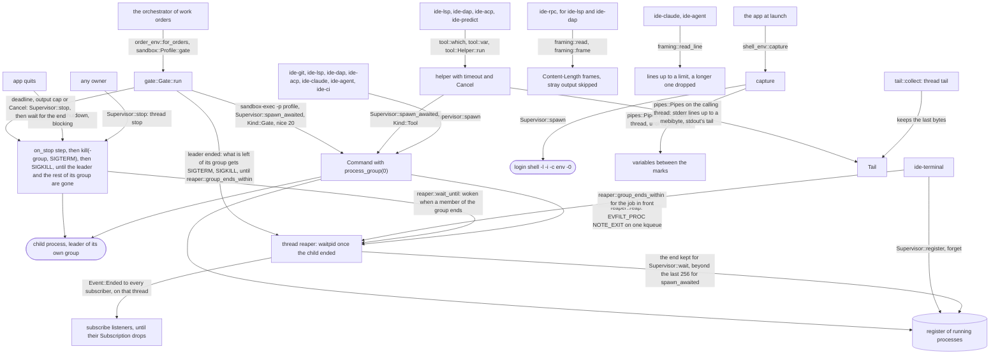

# ide-process

The one register of every process the app starts or adopts: each runs in a process group of its own, is listed for
the activity view, and is ended in order — graceful step, SIGTERM, SIGKILL — when it is stopped or the app quits. One
reaper thread hears through kqueue when any of them ends, so no child costs a thread of its own. It also reads the
login shell's environment, which every other child process is started with, serves a process's pipes from the thread
that waits for it, keeps the tail of a process's output, frames the messages language servers and debug adapters
exchange on their standard streams, and runs the short-lived helper programs others need (`tool`): found on the login
shell's PATH, started with that environment only, with a time limit, a way to cancel and the last mebibyte of each
stream kept. Ending a process ends its whole group, also what is left of it once the leader is gone.

For work orders (phase 13) it runs gate commands as `Kind::Gate` (`gate`): with a deadline and a cap on their output,
past which the whole process group ends, and a run that returns only once that end is confirmed, also for what a
gate left behind in its group. `sandbox` builds the `sandbox-exec` profiles of the own agent's shell tool and of gates
(E187): writing only in given folders and a per-run temp folder, the network off or on (`sandbox-exec` cannot limit it
to domains), the home folder hidden except the tool folders, Unix sockets closed except a list. `order_env` narrows
the login shell's environment for orders (E186): a list of names, no SSH agent, nothing named like a credential, and
an empty `credential.helper` for git.

The API is documented in [`src/lib.rs`](src/lib.rs) and its modules.
