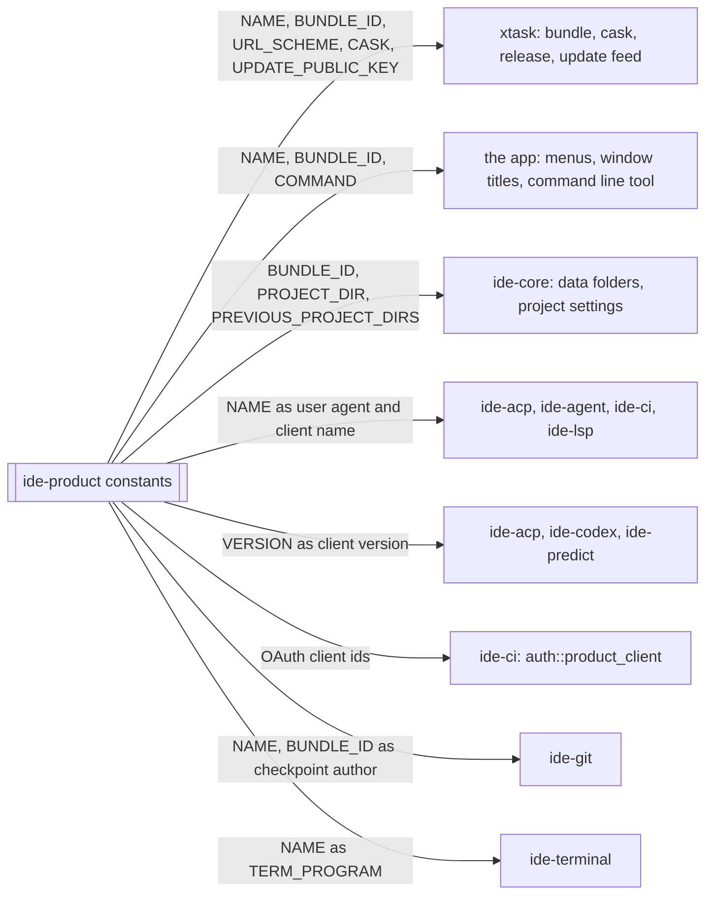

# ide-product

The product's display name, its version and the identifiers its stored data hangs on, kept in one place (E18). It has no code that runs: the other crates, the app and the build tool read its constants at compile time.

The API is documented in [`src/lib.rs`](src/lib.rs).
