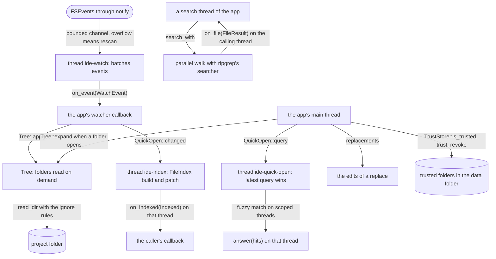

# ide-project

A project folder without a window: its tree read one folder at a time, changes on disk, quick open, project search and replace, the `.editorconfig` settings of its files and whether the user trusts the folder. The watcher and quick open run threads of their own and answer through callbacks; the rest blocks on the calling thread. No process is started.

`search_panel` and `files_panel` hold what the app's search and files panels decide without AppKit (E98): the current search with its matches per file and status line, and what a click, the context menu and a new name mean in the tree.

The API is documented in [`src/lib.rs`](src/lib.rs) and its modules.
