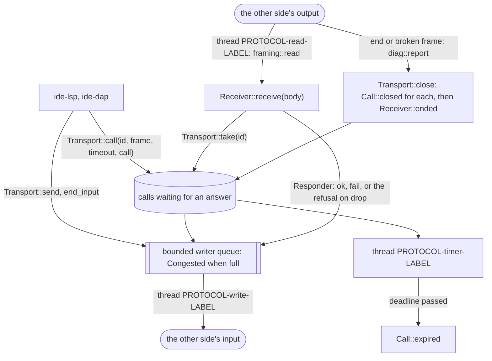

# ide-rpc

The transport language servers (`ide-lsp`) and debug adapters (`ide-dap`) share: `Content-Length` frames over a
pair of byte streams, calls that wait for an answer until a deadline, and requests from the other side that are
always answered, even when their handler forgets them. What a frame's body means is left to the protocol on top.

The API is documented in [`src/lib.rs`](src/lib.rs) and its modules.
