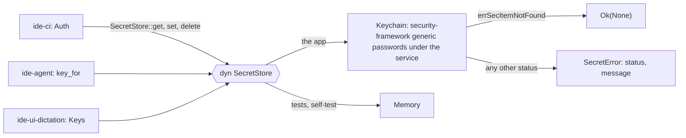

# ide-secrets

The one place the app keeps secrets: CI tokens (`ide-ci`), the own agent's provider keys (`ide-agent`) and the dictation keys (`ide-ui-dictation`). The keychain items live under the app's service name, one account per secret; tests and the self-test keep them in memory and leave the keychain alone (R4).

The API is documented in [`src/lib.rs`](src/lib.rs).
