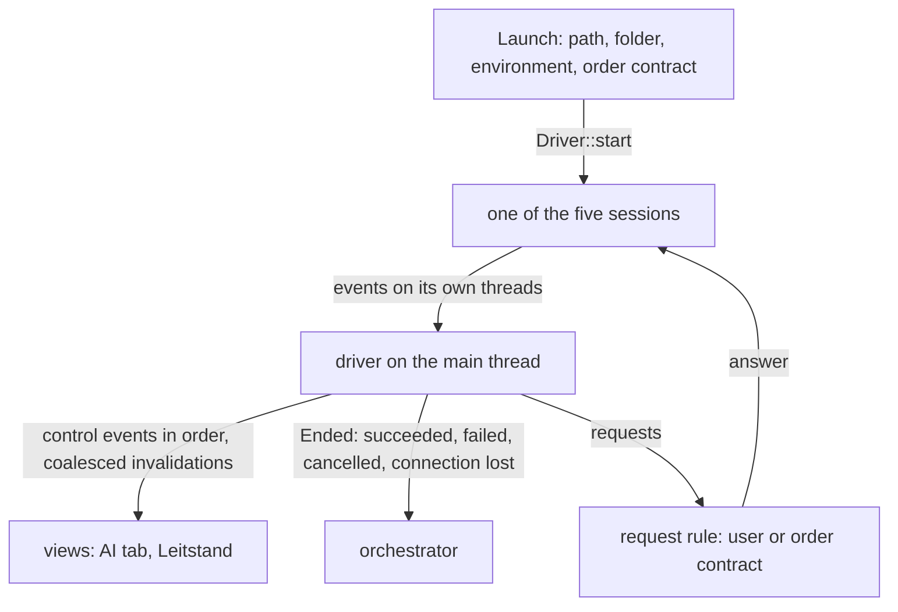

# ide-session

One driver over every agent session (docs/phase-13.md, B37a): Claude, Codex, OpenCode, ACP agents and the own agent,
with or without a tab. It starts the session, sends prompts after a checkpoint, answers requests by the rule it is
handed, fans the events out to any number of views and ends every turn with a typed result.

The API is documented in [`src/lib.rs`](src/lib.rs).
