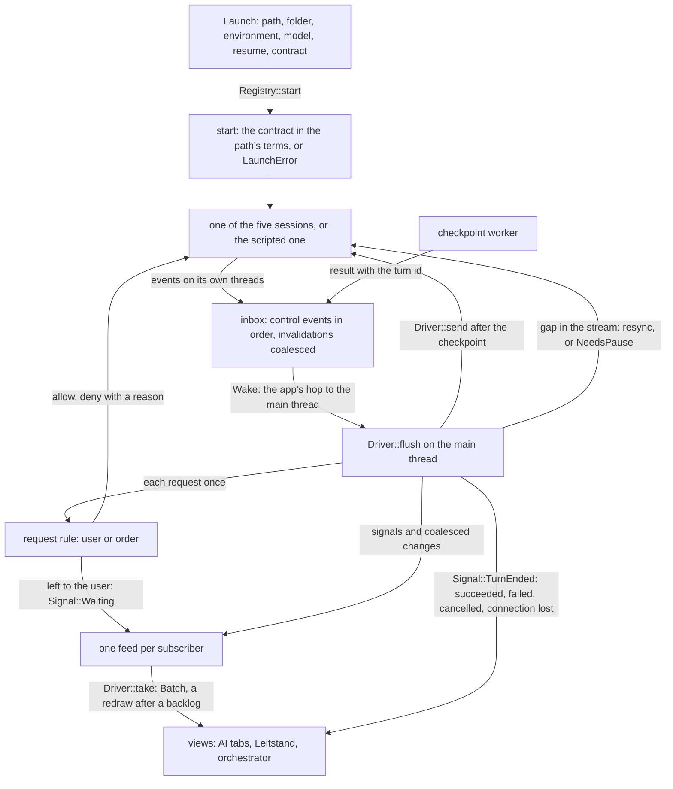

# ide-session

One driver over every agent session (docs/phase-13.md, B37a, E165): Claude, Codex, OpenCode, ACP agents and the own agent, with or without a tab. `Registry::start` starts a `Launch` under a `SessionId` the app keeps in its context; the `Driver` sends prompts after a checkpoint, answers requests by the `RequestRule` it is handed, fans the events out to any number of subscribers and ends every turn with a typed `TurnEnd`. An order's contract becomes each path's own bounds (E173); OpenCode and ACP agents take no role in orders.

The API is documented in [`src/lib.rs`](src/lib.rs).
