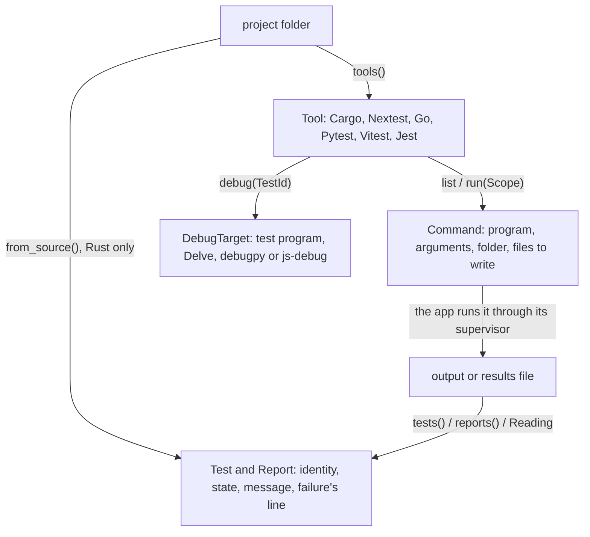

# ide-test

Finding, running and debugging tests (E110), without AppKit and without starting processes: an adapter per tool
says which commands list and run tests and reads what they print, each test as it starts and ends where the tool
says so. `cargo test` is read from libtest's text, cargo-nextest from its experimental libtest JSON, Go from
`go test -json`, pytest from Dango's plugin (`dango_pytest.py`), Vitest and Jest from Dango's reporters
(`dango_vitest.mjs`, `dango_jest.cjs`). Rust tests, whose listing builds the project, are read from the sources until
a listing or a run names them. A test's identity is kept apart from its place in the source; recordings of each tool's
output per version keep the readers honest (R29). A `Reading` reads a run as its output grows, each line once, and
names the reports that changed, so a poll costs what came since the last one.

The API is documented in [`src/lib.rs`](src/lib.rs).
