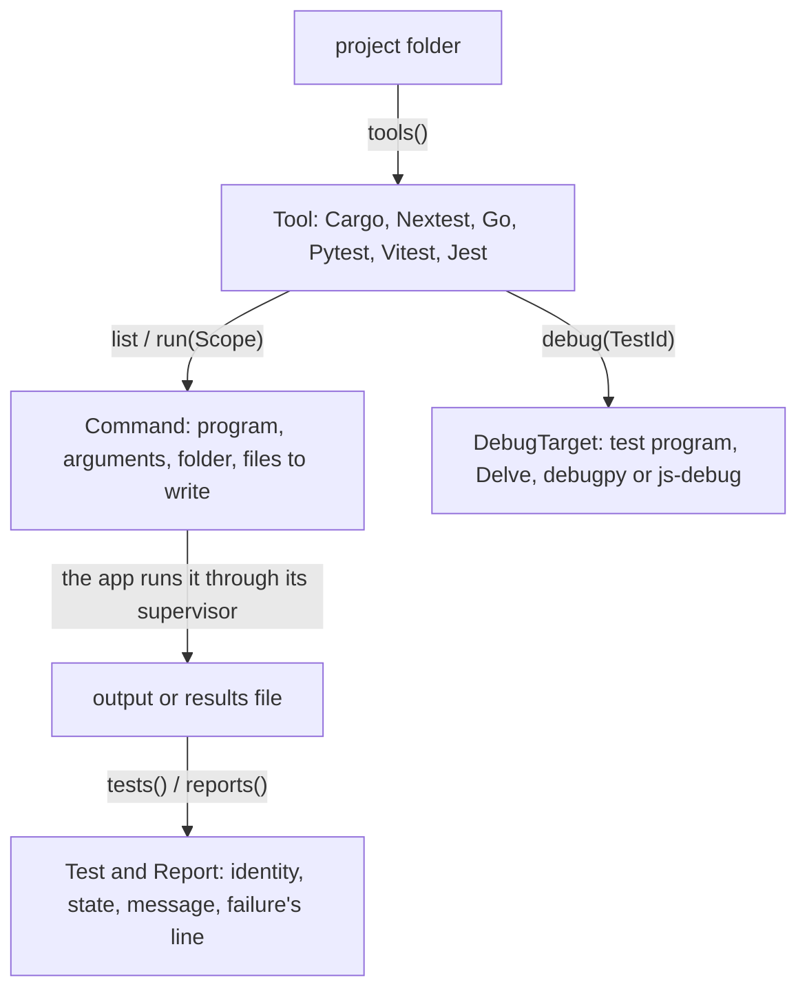

# ide-test

Finding, running and debugging tests (E110), without AppKit and without starting processes: an adapter per tool
says which commands list and run tests and reads what they print. `cargo test` is read from libtest's text,
cargo-nextest from a JUnit report its own tool configuration asks for, Go from `go test -json`, pytest from Dango's
plugin (`dango_pytest.py`), Vitest and Jest from their JSON results. A test's identity is kept apart from its place
in the source; recordings of each tool's output per version keep the readers honest (R29).

The API is documented in [`src/lib.rs`](src/lib.rs).
