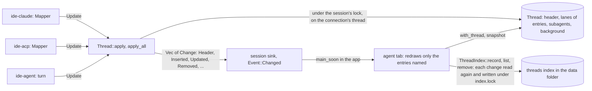

# ide-thread

The one thread model every agent connection fills, shaped like ACP v2: a thread with its timeline, the subagents it started with timelines of their own, and the work it keeps running in the background, plus the index of threads the session manager lists. It holds data only: no threads, no processes, no I/O except the index file. A connection changes a thread only through `Thread::apply`, which reports each change with a stable entry id.

The API is documented in [`src/lib.rs`](src/lib.rs) and its modules.
