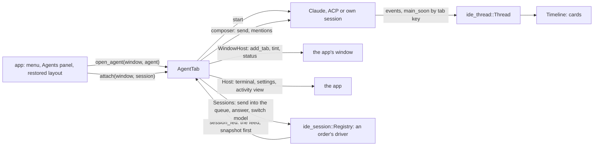

# ide-ui-agent

The AI tab: one agent session per tab with its timeline, composer and status, as the official Claude Code extension
shows it, drawn natively; the Agents panel with its sessions; and the own agent's settings (E6). Claude runs through
`ide_claude::Session`, other agents over ACP through `ide_acp::Session`, the own agent through `ide_agent::Session`.
A tab can also follow a session of the app's `ide_session::Registry` it did not start, such as a work order's (E184):
it subscribes to the driver's feed, sends the user's messages into the driver's queue and leaves the session running
when it closes. A specification without a session shows as a document with inline comments (E178).
The crate knows a window only by its id (`ide_ui_common::window::Window`) and reaches the app's terminals, editors,
settings and activity view through its `Host` (E99).

The API is documented in [`src/lib.rs`](src/lib.rs).
