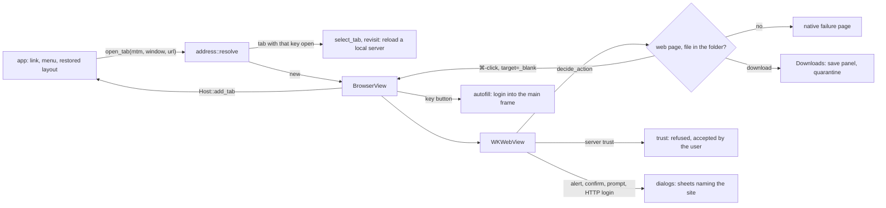

# ide-ui-browser

The browser tab (E17): a `WKWebView` below a navigation row, which also previews a project's dev server (I7). Every
tab shares one persistent website data store; pages get no way into the app, open local files only inside the
window's folder and other apps' schemes never. Pop-ups open as tabs, downloads ask where to save and are marked as
coming from the web, HTTP logins and certificates accepted for a development server live in memory until the app
quits. The crate knows a window only by its id: the app adds, selects and closes the tabs and holds the browser's
`State` through `Host` (E99).

The API is documented in [`src/lib.rs`](src/lib.rs).
