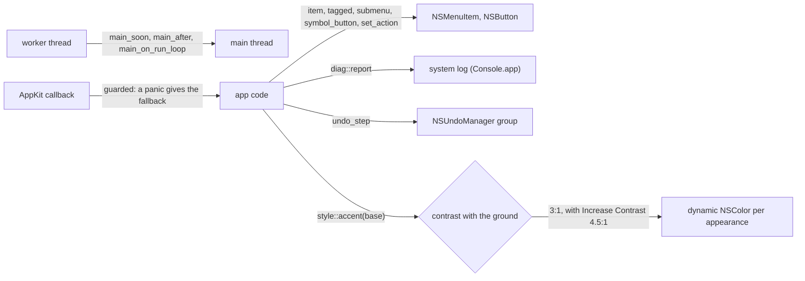

# ide-ui-common

What the app's AppKit parts share (E99): helpers that build controls and menu items, hops to the main thread,
callbacks that contain a panic, reports to the system log, one undoable step in a text view, and the AI tab's sizes,
fonts and colours with the contrast rules of agent accents (E66). It holds no state of its own beyond the colour
caches; the other `ide-ui-*` crates and the app build on it.

The API is documented in [`src/lib.rs`](src/lib.rs).
