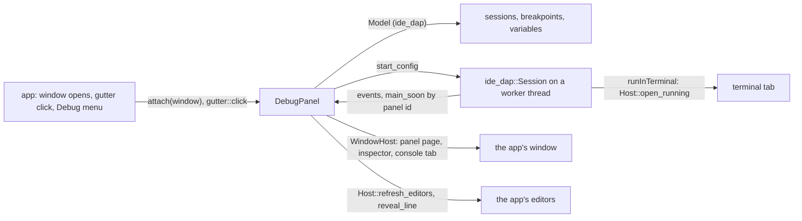

# ide-ui-debug

The debugger (B1, E94): the Debug panel with sessions, threads, call stacks and breakpoints, the inspector with the
selected frame's variables and watch expressions, the Debug menu and the debug console as a tab. The protocol and the
adapters are `ide_dap`'s. The crate knows a window only by its id (`ide_ui_common::window::Window`) and reaches the
app's editors and terminals through its `Host`; the app draws the breakpoints and the paused line in its editors from
what `gutter` and `DebugPanel` say (E99).

The API is documented in [`src/lib.rs`](src/lib.rs).
