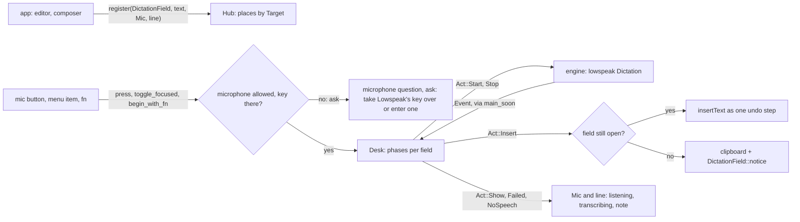

# ide-ui-dictation

Dictation into the app's text fields, the AI composer and the editor, through lowspeak (E13, E99): the microphone
button and line beside a field, the menu item, fn as in Lowspeak, the app's own API keys and the questions about them.
One recording runs at a time, bound to the field that had the focus when it started; its text goes in at that field's
cursor as one undo step. The app registers each field as a `DictationField` and holds the dictations in its context
through `Host`; the crate knows no editor and no AI tab. Without the feature `engine` only that trait and the
shortcut's spelling remain, so builds without dictation never compile whisper.cpp. See [docs/dictation.md](../../docs/dictation.md).

The API is documented in [`src/lib.rs`](src/lib.rs).
