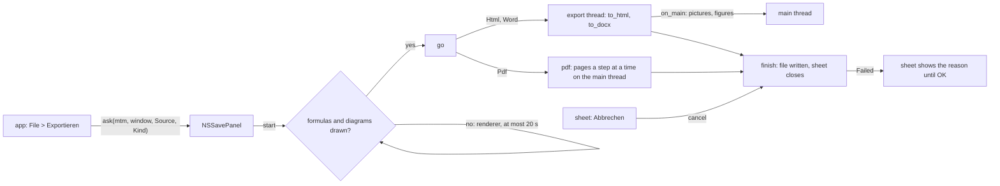

# ide-ui-export

A Markdown document as PDF, a self-contained HTML page or a Word file (E99), through splat's crates. Formulas and diagrams go in as the hidden renderer drew them, pictures come from the document's folder and from the web only in a trusted folder (E45). The file is built on a thread of its own; it comes to the main thread only for AppKit's pictures and text, while a sheet on the window says what runs and offers to cancel it. The app hands in what to export as a `Source` and holds the running exports in its context through `Host`; the crate knows no editor.

The API is documented in [`src/lib.rs`](src/lib.rs).
