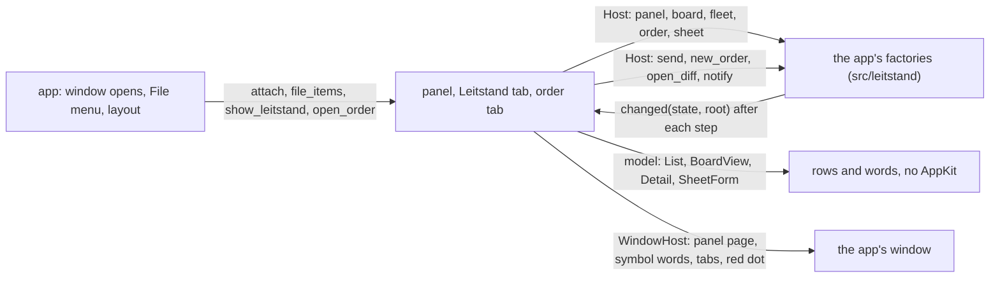

# ide-ui-factory

The Leitstand's views (phase 13, E175, E183, E185): the panel "Leitstand" beside the activity bar with a folder's work orders by station, the Leitstand tab with fleet line, station strip and sortable table, the tab of one order with its timeline, request cards, evidence (deviations first) and the buttons G1 and G2, the sheet "Neuer Auftrag", the dialog "Leitstand für <Ordner>" and the items of "Ablage ▸ Auftrag". What they show is decided in `model` without AppKit (E98), from the models of `ide_factory`. The orchestrator is the app's: the crate reaches it through its `Host`, and windows by their id through `ide_ui_common::window` (E99). The app hands the crate its `State` where it has the app context at hand and calls `changed` after every step of a folder's factory.

The API is documented in [`src/lib.rs`](src/lib.rs).
