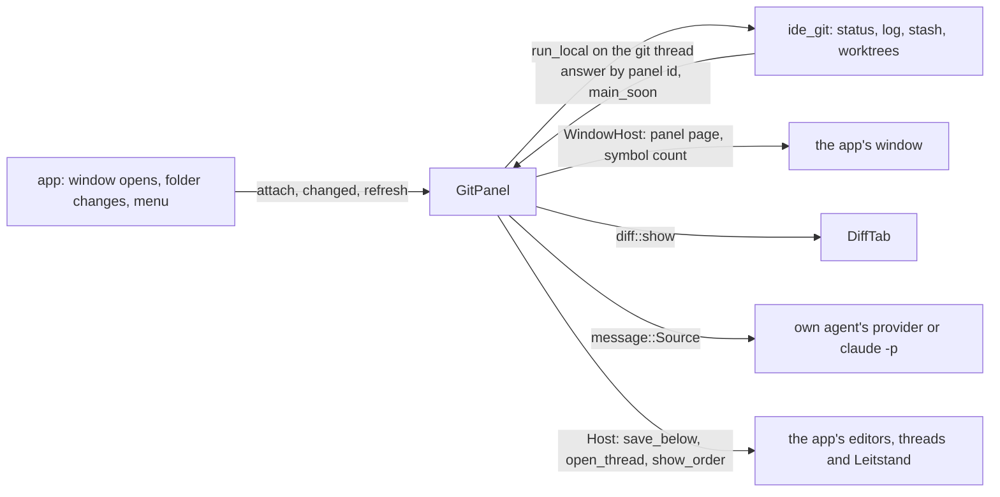

# ide-ui-git

The Git panel of the sidebar, the diff tab, the branch item of the toolbar, commit messages written by a model (E88),
and worktree threads (I1). git runs only in folders the user trusts (E22) and always off the main thread;
destructive operations ask first (E27). The crate knows a window only by its id (`ide_ui_common::window::Window`)
and reaches the app's editors, threads and agent settings through its `Host` (E99). The worktree logic itself is
`ide_git::thread_trees` (F49); a work order's worktree shows in the panel with only "Im Leitstand zeigen", which goes
to the app through `Host::show_order` (F50).

The API is documented in [`src/lib.rs`](src/lib.rs).
