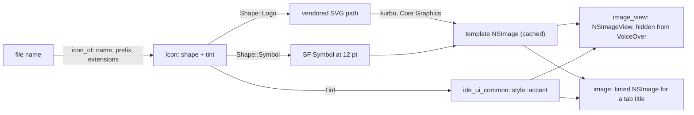

# ide-ui-icons

The icon of a file in lists and on tabs (E66): the logo of a common language from Simple Icons, vendored in `assets/simple-icons` at the repository's root, or an SF Symbol for every other kind of file, each in a system colour that keeps its contrast in every appearance. The logos are parsed from their SVG path once and drawn by Core Graphics as template images.

The API is documented in [`src/lib.rs`](src/lib.rs).
