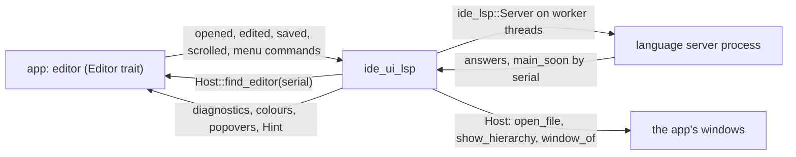

# ide-ui-lsp

The language servers of the editors (E10, E140): starting and installing them per folder and language, telling them every edit, and what their answers show in an editor: diagnostics, semantic colours, completion, hover, signature help, navigation, code actions, renaming, formatting, inlay hints and the status bar. The protocol and the server registry are `ide_lsp`'s. The crate reaches an editor only through the `Editor` trait, which the app's text view implements, and the app through its `Host`; inlay hints go to the editor as `Hint`s, which it shows as its insets (E81, E144).

The API is documented in [`src/lib.rs`](src/lib.rs).
