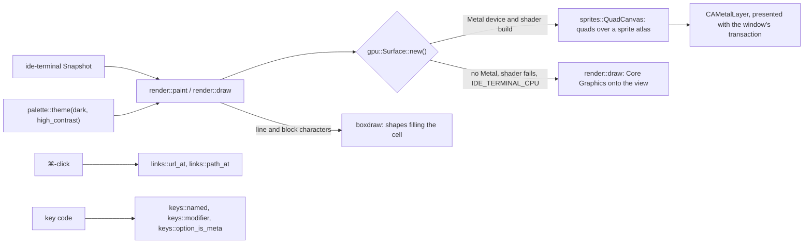

# ide-ui-terminal

How a terminal tab draws its screen (E8, E76): the monospaced faces and the cell they fill, the colours of the light
and dark appearance, line and block characters as shapes, and one pass over a snapshot of `ide-terminal` that paints
backgrounds, selection, text, underlines, cursor and marked text onto either Core Graphics or Metal quads. Besides
drawing it holds what a ⌘-click points at, Mac key codes as terminal keys, and the view's decisions that need no
AppKit (`model`). The view, its input and its session stay in the app.

The API is documented in [`src/lib.rs`](src/lib.rs).
