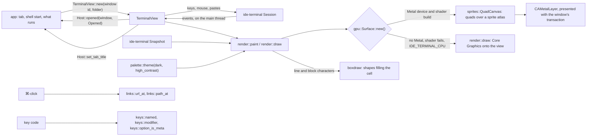

# ide-ui-terminal

A terminal tab's view and how it draws its screen (E8, E9, E76). `TerminalView` is the layer-backed view that hands
an `ide-terminal` session keys, input-method text, mouse, pastes and drops, reads its screen to VoiceOver and shows
banners for a dev server and short notices above it. Drawing covers the monospaced faces and the cell they fill, the
colours of the light and dark appearance, line and block characters as shapes, and one pass over a snapshot that
paints backgrounds, selection, text, underlines, cursor and marked text onto either Core Graphics or Metal quads.
Besides that it holds what a ⌘-click points at, Mac key codes as terminal keys, and the view's decisions that need no
AppKit (`model`).

The tab, starting the shell with the login-shell environment and what runs in a terminal stay in the app. The app
installs a `Host` once: it keeps the views' registry in the app's state, shows what a view opened (a web address, a
file at a line, a new terminal in a folder) and names tabs. A view knows its window only by id.

The API is documented in [`src/lib.rs`](src/lib.rs).
