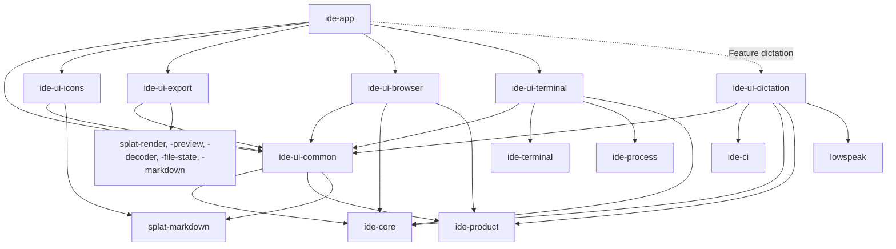

# Dango — Phase 11: Zed-Lücken und Architektur

**Freigegeben am 2026-11-12.** Die Entscheidungen E81–E102 und die Risiken R14–R19, R21 und R22 stehen als
Kurzfassung in [plan.md](plan.md); die Einzelheiten hier sind ebenso verbindlich. E89, E90 und R20 sind mit B11
entfallen. Die Nummern lauteten im Entwurf E77–E98 und wurden um vier verschoben, weil plan.md E77–E80 inzwischen
selbst vergeben hat. Die Kürzel B…
stammen aus dem Vergleich mit Zed (B1–B18) und aus dem Architektur-Auftrag des Owners (B19–B23); B24 ist ein späterer Wunsch des Owners. *Review:* Codex hat den Entwurf am 2026-11-12 gegen Code und
plan.md geprüft; seine 18 Befunde (C1–C18) sind eingearbeitet und an der jeweiligen Stelle markiert. C8 (E76 ist in
plan.md schon vergeben, Terminal mit Metal) ist durch die Nummern E81–E100 erledigt.

Umfang: B14 Code Actions/Inlay Hints/Signaturhilfe · B15 LSP-Navigation · B16 Git-Komfort ·
B4 Edit Prediction · B1 Debugger · B19 UI-Crates · B20 Fuzzing und Property-Tests · B21 Model/View-Trennung ·
B22 Thread-Locals · B23 Doku und Doctests · B24 Subagents und Hintergrundprozesse im Sitzungskopf.

## Reihenfolge

| Stufe | Inhalt | Größe | Warum an dieser Stelle |
|---|---|---|---|
| 1 Absicherung | B20, B23, B24 | S–M | Unabhängig von allem; der neue DAP-Parser aus Stufe 4 bekommt sein Fuzz-Ziel von Anfang an. B24 baut nur auf Vorhandenem auf (Thread-Modell, Aktivitäts-Popover) und kann jederzeit dazwischen |
| 2 Editor | B14, B15, B16 | M–L | Beginnt mit dem Prototyp von E81 als Sperre: Erst wenn er die Abnahme besteht, bauen B14, B16 und später B4 und B1 darauf; vor E82 kommt der neue Anwendungsweg für Workspace-Edits |
| 3 Struktur | B22, B21 | M–L | Vor den großen neuen Oberflächen (Debug-Panel, Vorhersage), damit die gleich im neuen Muster entstehen |
| 4 Vorhersage und Debugger | B4, B1 | L–XL | B4 braucht E81, B1 braucht E81 und die Struktur aus Stufe 3; B1 legt das Prozess-Eigentum fest, bevor die Oberfläche entsteht |
| 5 Build | B19 | M | Teilschnitt (E99); profitiert von den Grenzen aus Stufe 3 |

Jede Stufe endet wie die Phasen in plan.md: `make check` grün, `cargo xtask selftest` mit neuen Szenarien,
`make perf` (E25), VoiceOver-Prüfung der neuen Ansichten, neue Texte in `en.lproj` und den 33 weiteren Sprachen nach
[glossary.md](glossary.md) (E15), dazu die HIG-Abnahme (E101).

## HIG-Konformität

- **E101 Apples Human Interface Guidelines als Abnahme** *(ergänzt E3)*. Grundlage sind die HIG-Seiten
  [Keyboards](https://developer.apple.com/design/human-interface-guidelines/keyboards) und
  [Generative AI](https://developer.apple.com/design/human-interface-guidelines/generative-ai) (Stand 2026-06-08);
  wo die HIG nichts sagt, ist Xcode das Vorbild, weil Mac-Entwickler dessen Bedienung kennen. Die Stufen 1, 3 und 5
  ändern nichts an der Oberfläche, außer B24; E101 betrifft B24, B14, B15, B16, B4 und B1.
- **Menüs.** Jeder neue Befehl steht in der Menüleiste, auch wenn er ein Kürzel, einen Knopf oder ein Kontextmenü
  hat. Was gerade nicht geht, ist ausgegraut, nicht ausgeblendet; das gilt auch für die Knöpfe des Debuggers. Neues
  Menü „Debuggen“ zwischen „Gehe zu“ und „Fenster“ (HIG-Reihenfolge: App, Ablage, Bearbeiten, Format, Darstellung,
  App-eigene Menüs, Fenster, Hilfe).
- **Kürzel.**
  - Kein Standardkürzel aus der HIG-Tabelle wird für etwas anderes benutzt: ⌘. ist „Vorgang abbrechen“ (bei Dango:
    Debug-Sitzung stoppen, wie in Xcode), ⇧⌘A ist „Auswahl aufheben“, ⌥⌘I ist „Inspektor“, F11 zeigt den
    Schreibtisch, ⌃F1–⌃F7 gehören der Tastaturbedienung des Systems, ⇧⌘Leer und ⌥⌘Leer belegt das System.
  - Eigene Kürzel nur für häufige Befehle, mit ⌘ als Hauptmodifikator; ⌃ nur, wo Xcode es vorgibt.
  - Befund im heutigen Stand: `view.whitespace` liegt auf ⌥⌘I, dem Standard für den Inspektor
    (`crates/ide-core/src/keymap.rs`). Es wandert ohne Kürzel ins Menü „Darstellung“; ⌥⌘I blendet künftig den
    Inspektor ein und aus (E94).
  - Bewusste, belegte Ausnahmen bleiben: ⌘T für „Neuer Tab“ und ⇧⌘[ / ⇧⌘] für den Tabwechsel wie in Safari
    (die HIG-Bedeutungen Schriften-Fenster und Ausrichten ergeben in Dango keinen Sinn, was die HIG erlaubt).
  - Neuer Test in `ide-core`: Die Vorgabe-Kürzel werden gegen die Standardtabelle der HIG geprüft; ein Treffer schlägt
    fehl, außer er steht mit Begründung auf der Ausnahmeliste. Ein Selftest prüft zusätzlich gegen die eingeschalteten
    Systemkürzel des Macs (`com.apple.symbolichotkeys`) und meldet Überschneidungen in den Einstellungen.
  - Neuer Test: Jeder Befehl der Kürzeltabelle hat einen Menüeintrag.
- **Aufteilung des Fensters.** Navigation steht in der Seitenleiste, Details zur Auswahl im Inspektor am hinteren
  Rand (`NSSplitViewItem` als Inspektor, macOS 14+, E16), Vorübergehendes in Popovers und Menüs. Größere Bäume
  gehören nicht in ein Popover.
- **Steuerelemente.** Systemsteuerelemente statt eigener: Listen von Aktionen als `NSMenu`, Rückfragen als Sheet mit
  `NSAlert`, zerstörerische Knöpfe mit `hasDestructiveAction` und nie als Standardknopf (wie schon im Git-Panel,
  `crates/ide-ui-git/src/sheets.rs`), Symbole aus SF Symbols mit Beschriftung für VoiceOver.
- **Materialien.** Seitenleiste und Inspektor bekommen ihr Material vom System (ab macOS 26 Liquid Glass); keine
  eigenen Hintergründe darin, kein Glas auf Glas. Schwebende Fenster (Signaturhilfe, Vorschlags-Kasten) nutzen das
  Systemmaterial für Popovers.
- **Bedienungshilfen.** Alle neuen Ansichten laufen durch den Barrierefreiheits-Audit der Selftests
  (`src/selftest/a11y/audit.rs`) und die Fotos hell, dunkel, erhöhter Kontrast und Rechts-nach-links.
  - Alles geht ohne Maus: Haltepunkt der Cursorzeile mit ⌘\ (Xcode), Glühbirne über das Menü, Blame-Popover über
    das Menü.
  - Zustände nie nur über Farbe: ein ausgeschalteter Haltepunkt ist umrandet statt gefüllt, die angehaltene Zeile
    trägt einen Pfeil.
  - VoiceOver-Rotoren „Hinweise“ und „Haltepunkte“; Ansagen beim Anhalten am Haltepunkt und beim Übernehmen eines
    Vorschlags.
  - „Bewegung reduzieren“: kein eingeblendeter Ghost Text mit Animation.
  - Farben nach E66 (3:1, mit erhöhtem Kontrast 4,5:1).
  - Rechts-nach-links: Panels und Inspektor spiegeln, Code und Randspalte bleiben links-nach-rechts (E3).
- **Generative AI** (B16 Commit-Message, B4 Edit Prediction):
  - Kennzeichnen, wo AI arbeitet: Ghost Text ist als Vorschlag erkennbar. Eine erzeugte Commit-Message trägt bis
    zur ersten eigenen Änderung die Zeile „Von AI erstellt, bitte prüfen“, daneben „Neu erzeugen“ und Undo.
  - Vor dem ersten Senden an einen Anbieter außerhalb des Macs (Copilot, Cloud-Modell für Commit-Messages) fragt
    ein Sheet einmal je Anbieter um Erlaubnis und sagt, was gesendet wird (Datei-Inhalt rund um den Cursor bzw. der
    Diff). Die Erlaubnis lässt sich in den Einstellungen zurücknehmen. Lokale Modelle brauchen keine Erlaubnis; die
    Einstellungen sagen, dass der Code den Mac nicht verlässt.
  - „Gesendeten Inhalt zeigen“ neben dem Commit-Knopf zeigt genau den geprüften Text (E88).
  - Fortschritt konkret („Fasst 12 geänderte Dateien zusammen …“) mit Abbrechen; Fehler in einfachen Worten mit dem
    nächsten Schritt.
- **Begriffe.** Neue Fachwörter (Haltepunkt, Aufrufliste, Überwachter Ausdruck, Schnellkorrektur, Inlay-Hinweis)
  kommen zuerst in [glossary.md](glossary.md), dann in die Texte (E15); wo macOS einen Begriff schon benutzt, gilt
  der des Systems.

## Stufe 1 — Absicherung

### B20 Fuzzing und Property-Based Testing
*Umgesetzt am 2026-11-12:* sieben Ziele in sechs Crates (`cargo xtask fuzz`, Einzelheiten in
[development.md](development.md#fuzzing)), sieben Eigenschaften in `crates/ide-document/tests/properties.rs`, das
Selftest-Szenario `editor-undo`.

Auswirkung: Abstürze durch kaputte oder bösartige Eingaben von Language Servern, Agenten, Terminalprogrammen und git
werden vor dem Nutzer gefunden. Fuzzing beweist keine Panic-Freiheit, es findet Abstürze in den Eingaben, die es
durchprobiert; der Nutzen wächst mit der Laufzeit.

- **E95 Fuzzing mit cargo-fuzz, getrennt von `make check`.** cargo-fuzz braucht nightly (Sanitizer), Dango ist auf
  1.99.1 festgelegt (E16). Deshalb `make fuzz` mit `cargo +nightly fuzz`, je Ziel eine feste Laufzeit (Standard
  60 s, `FUZZ_SECONDS=` überschreibt), Fundstücke werden als Regressionstest in die normale Testsuite übernommen und
  laufen dort mit 1.99.1. Startkorpus aus den vorhandenen Mitschnitten (`crates/ide-claude/tests/fixtures/*.ndjson`
  u. a.). Ziele, je Crate ein Ordner `fuzz/`:
  1. `ide-terminal`: `scan.rs` (OSC 133, OSC 7, Dev-Server-Erkennung) und `parse_procargs`. Der eigentliche
     ANSI-Parser ist `vte` aus alacritty_terminal und wird dort bereits gefuzzt; geprüft wird Dangos eigener Teil.
  2. `ide-lsp`: `framing.rs` (Content-Length-Rahmung) und die Umwandlung eingehender Nachrichten (`incoming.rs`).
  3. `ide-acp`: eingehende Nachrichten bis zur Abbildung aufs Thread-Modell (`mapping.rs`).
  4. `ide-git`: `diff::parse` (heute `pub(crate)`, bekommt einen Einstieg hinter dem Feature `fuzzing`).
  5. Zusätzlich, weil der Auftrag „AI-Streamings“ nennt: `ide-claude` `protocol::parse` plus Abbildung und
     `ide-agent` `sse.rs` (SSE-Parser für alle Anbieter des eigenen Agenten).
  6. In Stufe 4 kommt der neue Parser dazu: `ide-dap`.
- **E96 proptest in `make check`.** Feste Fallzahl, Fehlschläge in `proptest-regressions/` eingecheckt, kein
  Zufall zwischen zwei Läufen von `make check` (fester Seed). Ziele in `ide-document`: `Document::apply` und
  `replace_all` (Text bleibt gleich dem Ergebnis eines einfachen Referenzmodells), Positionsabbildung
  UTF-8/UTF-16/LSP (hin und zurück verlustfrei), `merge.rs` (Dreiwege-Zusammenführung des Konfliktbalkens).
  Undo/Redo selbst liegt bei AppKit (`NSUndoManager`), nicht in `ide-document`; geprüft wird deshalb die
  Eigenschaft, auf der Undo aufbaut: eine Änderung und ihre Umkehrung ergeben den Ausgangstext. Das Undo im Editor
  deckt ein Selftest-Szenario mit zufälligen Edit-Folgen ab.

Abnahme: Alle Ziele laufen je 10 Minuten ohne Fund oder mit behobenen Funden; proptest grün in `make check`.

### B23 Dokumentation und Doctests
*Umgesetzt am 2026-11-12:* je Crate ein Doctest und eine README mit Diagramm, geprüft von `tests/crate_readmes.rs`.

Auswirkung: Die zentralen Schnittstellen haben ein ausführbares Beispiel, das bei jeder Änderung mitgeprüft wird.

- **E100 Doctests und Crate-READMEs.** `cargo test --workspace` führt Doctests bereits aus; es gibt nur keine. Je
  Fenster-freiem Crate bekommt die zentrale API ein lauffähiges Beispiel im Doc-Kommentar, u. a. `Lane::ask`
  (ide-core), `Document::apply` (ide-document; ein `Document::edit` gibt es nicht), `Tree::expand`
  (ide-project), `Supervisor` (ide-process), `protocol::parse` (ide-claude), `diff` (ide-git). Beispiele ohne Netz und
  ohne fremde Programme; was einen Prozess braucht, bekommt `no_run`. Je Crate eine `README.md` mit einem
  Mermaid-Diagramm des Kontrollflusses (wer ruft wen, welche Threads, welche Prozesse); `lib.rs` bleibt die
  API-Dokumentation (CLAUDE.md), die README verweist darauf und wiederholt sie nicht. Ein Test prüft, dass jedes
  Crate eine README mit Diagramm hat.

Abnahme: `cargo test --doc --workspace` mit mindestens einem Beispiel je Crate grün.

### B24 Subagents und Hintergrundprozesse im Sitzungskopf
*Umgesetzt am 2026-11-12.*

Auswirkung: Man sieht der Sitzung an, ob sie gerade Subagents oder Shells laufen hat, und kommt mit einem Klick an
deren Liste mit Laufzeit, letzter Ausgabe und Stopp, ohne `/tasks` zu tippen.

Befund: Die Daten gibt es schon. Das Thread-Modell führt je Sitzung Subagents und Hintergrundarbeit
(`ide-thread`, Claude füllt beides aus `task_started/progress/updated` und `background_tasks_changed`,
`ide-claude/src/mapping.rs`). Der Kopf hat dafür heute einen einzigen Knopf „Aufgaben dieser Sitzung“
(`list.bullet.indent`, `crates/ide-ui-agent/src/header.rs`), der das Aktivitäts-Popover auf diese Sitzung beschränkt
(`activity::show_tab`). ACP-Agenten (Codex, Gemini) melden weder Subagents noch Hintergrundarbeit.

- **E102 Zwei Knöpfe statt „Aufgaben dieser Sitzung“** *(Wunsch des Owners, Symbol nach seiner Wahl; ändert die Kopfzeile aus E4/AI-Tab)*.
  Rechts im Kopf des AI-Tabs, an der Stelle des bisherigen Knopfs: `person.2` für die Subagents und
  `terminal` für die Hintergrundprozesse, 13 pt wie die Nachbarn.
  - *Symbol:* SF Symbols hat kein Roboter-Motiv (auf macOS 27 geprüft: `robot`, `robot.fill` fehlen). Statt eines
    eigenen Symbols nimmt der Knopf `person.2`, das die Aktivität schon für Subagent-Zeilen benutzt
    (`src/activity/mod.rs`); Knopf und Liste sehen damit gleich aus, und E101 braucht keine Ausnahme. Verworfen:
    `apple.intelligence` (Apples Marke, laut HIG nicht für eigene Funktionen), `brain` (verwechselbar mit „Denken“),
    `arrow.triangle.branch` (Git-Branch), `sparkle` (steht für die Sitzung selbst).
  - *Zustand ohne Zahl im Symbol* (wie E69 und die Aktivität): Läuft etwas, ist das Symbol in Akzentfarbe, sonst
    sekundär; Nebensachen (`ambient`) zählen nicht als laufend. Die Zahl steht im Tooltip und in der VoiceOver-Beschriftung („Subagents: 2 laufen, 3 fertig“,
    „Hintergrundprozesse: 1 läuft“), damit der Zustand nicht nur an der Farbe hängt (E101).
  - *Ausgegraut statt ausgeblendet* (E101): ohne Einträge und bei Agenten, die nichts melden; der Tooltip sagt
    warum („Diese Sitzung hat noch keine Subagenten gestartet“, „Codex meldet keine Subagenten“). Das gilt für
    ACP-Agenten und den eigenen Agenten; nur Claude meldet beides.
- **Liste.** Ein Klick öffnet das vorhandene Aktivitäts-Popover, beschränkt auf diese Sitzung und eine Art; kein
  zweites Popover. `activity` bekommt dafür neben `only` einen Filter (Subagents / Hintergrund), die Zeilen bauen
  die vorhandenen Funktionen, aufgeteilt in je eine für Subagents und Hintergrund.
  - Subagents: alle Subagents der Sitzung, auch fertige, laufende oben, je Zeile Typ und Beschreibung, Status,
    Laufzeit, Tokens, letztes Werkzeug; „Zeigen“ springt zur Karte in der Zeitleiste, „Stopp“, wo Claude es
    anbietet. Workflows stehen hier, weil sie Agenten starten.
  - Terminal: Hintergrund-Shells und Monitore der Sitzung, laufende oben, beendete mit Ende-Status darunter, bis
    die Sitzung neu beginnt (das Thread-Modell behält dafür die letzten 50 beendeten; was die CLI beim Beenden
    ihres Prozesses noch laufen hatte, steht als „Gestoppt“ da); je Zeile Befehl, Status, Laufzeit, letzte Ausgabezeile; „Ausgabe zeigen“ (ganze
    Ausgabe im Tab), „Stopp“. Was der Agent als Nebensache meldet (`ambient`), steht gedämpft.
  - Die Liste aktualisiert sich offen weiter; Anlass ist die vorhandene Meldung `refresh.overview`
    (`crates/ide-ui-agent/src/refresh.rs`), die auch die Knöpfe neu einfärbt.
- **Menü und Tastatur** (E101): „Subagenten dieser Sitzung“ und „Hintergrundprozesse dieser Sitzung“ im Menü „Darstellung“,
  ohne eigenes Kürzel, ausgegraut außerhalb eines AI-Tabs. `/tasks` öffnet weiter die gemeinsame Übersicht beider
  Arten.
- **Abgrenzung.** Claude im Terminal-Tab hat keinen Sitzungskopf; dessen Kindprozesse zeigt die Aktivität schon als
  Vordergrundprozesse des Terminals.

Abnahme: Selftest mit einem Claude-Mitschnitt, der zwei Subagents (einer im Hintergrund) und eine Hintergrund-Shell
startet: Farbe, Tooltip und VoiceOver-Text beider Knöpfe vor, während und nach dem Lauf; beide Listen mit den
erwarteten Zeilen; „Stopp“ und „Zeigen“; ausgegraute Knöpfe in einer ACP-Sitzung; Fotos hell, dunkel und mit
erhöhtem Kontrast; Barrierefreiheits-Audit.

## Stufe 2 — Editor

### E81 Einblendungen (gemeinsamer Baustein)
*Umgesetzt am 2026-11-12, Sperre bestanden (`editor-insets`).* Abweichung beim Zeichnen: Die Einblendungen zeichnet
nicht das Overlay, sondern TextKits Layout-Fragment der Zeile nach ihrem Text (`src/editor/inset_fragment.rs`); im
Overlay fielen sie beim Scrollen hinter TextKits Text zurück, die Lücken standen leer. Das Overlay kennt ihre Lage
weiter für Klicks, Tooltips und Zeiger. Abweichung nach R14: TextKit 2 übergeht ein Kern-Attribut auf
dem letzten Codepunkt eines mehrteiligen Graphems; dort gilt der Ausweg ans Zeilenende. Ein Caret am Rand der Lücke
rückt ein eigener `NSTextLayoutManager` an deren rechte Kante, ohne TextKit 1. Der Kasten unter der Zeile entsteht
erst mit B4.

Inlay Hints, Ghost Text (B4), Blame (B16) und Inline-Werte des Debuggers (B1) zeigen Text, der nicht in der Datei
steht. TextKit 2 kennt dafür nichts Fertiges, und der Text darf nicht in den Speicher des Editors (Undo, Sichern,
Positionen).

- Am Zeilenende: gezeichnet in der vorhandenen Overlay-Ansicht (`src/editor/overlay.rs`), wie die Platzhalter der
  Faltung. Es braucht keinen Platz im Text.
- Mitten in der Zeile: Platz entsteht über ein Kern-Attribut auf dem Zeichen davor (eine Attributänderung, kein
  Text, kein Undo-Schritt), das Overlay zeichnet in die Lücke. Kopieren nimmt nur den Text mit, nicht die Lücke.
- *Review C4:* Kern ist ein Abstand zwischen zwei Zeichen, keine Einfügung. Wo es kein Zeichen davor in derselben
  Zeile gibt (Dokumentanfang, Zeilenanfang, leeres Dokument), gilt je Verbraucher ein fester Ausweg: Inlay Hints und
  Inline-Werte ans Zeilenende, Ghost Text in den Kasten unter der Zeile. Das Kern-Attribut sitzt immer auf dem
  letzten Codepunkt eines Graphems, nie mitten in einem.
- Klickbare Einblendungen (Inlay Hints mit Ort, Blame): Das Overlay lässt heute jeden Klick durch
  (`overlay.rs`); es bekommt eine Trefferprüfung nur für die Rechtecke der Einblendungen, alles andere geht weiter an
  den Text.
- Nur für den sichtbaren Bereich, nachgeführt beim Scrollen; Tastendruck bleibt unter 16 ms (E25).
- Rechts-nach-links-Oberflächen ändern nichts, Code bleibt links-nach-rechts (E3).
- VoiceOver: Das Overlay ist heute von der Bedienungshilfe ausgenommen. Einblendungen werden nicht als Teil der Zeile
  gelesen, sondern über einen eigenen Rotor „Hinweise“ mit Text und Zeile.
- **Prototyp als Sperre.** Vor jedem Verbraucher entsteht E81 allein und muss im Selftest bestehen: leeres Dokument,
  Zeilenanfang, Emoji und kombinierende Zeichen, japanische Eingabe mit offener Markierung, Cursor- und
  Klickposition links und rechts der Lücke, Faltung, Zeilenumbruch, klickbarer Hint, VoiceOver-Rotor, unverändertes
  Undo und unveränderte Datei nach dem Sichern, und der Nachweis, dass der Editor auf TextKit 2 bleibt (kein Aufruf
  von `layoutManager`, E7). Fällt ein Punkt durch, gilt für ihn der Ausweg oben, nicht ein Umweg über TextKit 1.

### B14 Code Actions, Inlay Hints, Signaturhilfe
*Umgesetzt am 2026-11-12.* Abweichungen: Die Glühbirne ersetzt die Zeilennummer der Cursorzeile, weil die Randspalte
keinen freien Platz hat; „Anlegen“ einer vorhandenen Datei ohne `overwrite`/`ignoreIfExists` bricht den Edit ab, wie
es das Protokoll beschreibt. Das Leistungsbudget misst, was Hinweise zum Tastendruck hinzufügen (unter 3 ms), weil
der absolute Wert von 16 ms auf einem ausgelasteten Mac auch ohne Hinweise nicht zu halten ist.

Auswirkung: Quick-Fixes (fehlender Import, Tippfehler, unbenutzte Variable), Typen im Text und die Parameterliste
beim Aufruf, wie in Zed und VS Code. Die Anfragen stehen schon in `crates/ide-lsp/src/features.rs`
(`code_actions`, `resolve_code_action`, `inlay_hints`, `signature_help`), das Anwenden fremder Edits über
`workspace/applyEdit` ebenfalls.

- **E82 Code Actions.** Glühbirne in der Randspalte (`ruler.rs`) der Cursorzeile, sobald es für die Stelle Aktionen
  gibt (Anfrage nach kurzer Ruhe, abgebrochen beim nächsten Tastendruck). ⌥⌘A (nicht ⌘., das ist „Abbrechen“, und
  nicht Xcodes ⇧⌘A, das ist „Auswahl aufheben“, E101), der Menüpunkt „Editor ▸ Schnellkorrektur …“ und das
  Kontextmenü öffnen die Aktionen als `NSMenu` am Cursor, bevorzugte Aktion oben; „Refactoring …“ und
  „Quellaktionen …“ (u. a. Importe ordnen) als eigene Menüpunkte. Die Glühbirne ist das SF Symbol `lightbulb`
  mit VoiceOver-Beschriftung. Befehle der Aktionen über `workspace/executeCommand`.
- **Voraussetzung für E82: ein neuer Anwendungsweg für Workspace-Edits** *(Review C1)*. Der heutige in
  `src/lsp/edits.rs` (`split`, `apply_workspace_edit`) ist für Code Actions nicht sicher genug: Er verwirft
  `TextDocumentEdit.version`, sammelt Edits je Pfad und führt alle Datei-Operationen (Anlegen, Umbenennen, Löschen)
  vor den Text-Edits aus, und das, bevor geprüft ist, ob ihre Pfade im Ordner liegen. Ein „bearbeiten, dann
  umbenennen“ ändert so seine Bedeutung, und eine veraltete Aktion kann neueren Text überschreiben. Der neue Weg
  (auch für Umbenennen und `workspace/applyEdit`):
  - Reihenfolge von `documentChanges` bleibt erhalten.
  - Erst wird alles geprüft, dann ausgeführt: jeder Pfad, auch die der Datei-Operationen, liegt nach Auflösen von
    Symlinks im Ordner; jede Version passt zur Revision des offenen Dokuments (E24), sonst wird die ganze Aktion mit
    „Die Datei hat sich inzwischen geändert“ verworfen.
  - Ein Undo-Schritt je Datei (E24), geschlossene Dateien wie beim Sichern geschrieben.
  - Scheitert ein Schritt beim Ausführen, endet der Vorgang; die Meldung nennt, welche Dateien schon geändert sind,
    und die geöffneten lassen sich je Datei per Undo zurücknehmen.
  - Tests: bearbeiten-dann-umbenennen, veraltete Version, Symlink aus dem Ordner hinaus, Undo nach Teilfehler.
- **E83 Inlay Hints.** Standard an, Schalter im Menü Ansicht und in den Einstellungen, je Sprache abschaltbar.
  Darstellung über E81 in Sekundärfarbe, kleinere Schrift. Neu abgefragt für den sichtbaren Bereich nach
  Änderung oder Scrollen und auf `workspace/inlayHint/refresh` (schon empfangen). Tooltip des Hints aus `tooltip`,
  Klick auf einen Hint mit Ort springt dorthin.
- **E84 Signaturhilfe.** Kleines Fenster über dem Cursor (wie die Vervollständigungsliste in `complete.rs`, mit
  Systemmaterial, nimmt nicht den Fokus), ausgelöst durch die Trigger-Zeichen des Servers und den Menüpunkt
  „Editor ▸ Parameter zeigen“ ohne eigenes Kürzel (⇧⌘Leer belegt das System, E101); aktiver Parameter
  hervorgehoben und von VoiceOver angesagt, ↑/↓ blättert durch Überladungen, solange die Vervollständigungsliste
  nicht offen ist; schließt bei Esc oder Verlassen des Aufrufs.

Abnahme: Selftest mit rust-analyzer und gopls je für Quick-Fix, Inlay Hint, Signaturhilfe; Leistungsbudget bei 10 000
Zeilen mit Hints an.

### B15 LSP-Navigation
*Umgesetzt am 2026-11-12.* Projekt-Symbole auf ⌥⌘O; die Symbolsuche startet keine Server für JSON, YAML, TOML, CSS
und HTML; rust-analyzer sucht mit `all_symbols`, sonst fände er nur Typen.

Auswirkung: Springen über das ganze Projekt statt nur innerhalb einer Datei.

- **E85 Navigation.**
  - Neue Anfragen in `ide-lsp`: `workspace/symbol` (+ `workspaceSymbol/resolve`), `textDocument/implementation`,
    `typeDefinition`, `declaration`, `prepareCallHierarchy` mit `incomingCalls`/`outgoingCalls`,
    `prepareTypeHierarchy` mit `supertypes`/`subtypes`; Fähigkeiten in `capabilities.rs` angemeldet.
  - Projekt-Symbole in Schnellöffnen: Eingabe mit `#` sucht Symbole statt Dateien (wie VS Code), zusätzlich
    Menüpunkt „Gehe zu Symbol im Projekt …“; Kürzel nach Abgleich mit der Kürzeltabelle (E26, ⌘T ist „Neuer Tab“).
  - Ein Server endet heute fünf Minuten nach dem letzten Editor (E10); der Zeitgeber läuft nur an, wenn ein Editor
    seinen Platz freigibt (`release` in `src/lsp/mod.rs`). *Review C17, Erweiterung von E10:* Die Symbolsuche hält
    die Server über eine eigene Ausleihe, unabhängig von Editoren. Eine Ausleihe endet fünf Minuten nach der letzten
    Symbolsuche; ein Server endet, wenn weder Editor noch Ausleihe ihn hält. Gestartet werden die Server der
    Sprachen, deren Dateien im Ordnerbaum stehen (ohne ignorierte), je Wurzel nach den Wurzelmarken des Registers,
    höchstens zwei Starts gleichzeitig, nur in vertrauten Ordnern (E22). Eine neue Eingabe bricht laufende
    Anfragen ab. Solange ein Server noch indexiert, zeigt die Liste „Wird indexiert …“ statt „Nichts gefunden“.
    Tests: Ablauf der Ausleihe ohne offenen Editor, Ordner mit drei Sprachen.
  - Implementierung, Typdefinition, Deklaration im Kontextmenü und Menü „Gehe zu“; mehrere Treffer in der
    vorhandenen Trefferliste der Referenzen (`navigate.rs`).
  - Aufruf- und Typhierarchie im Suche-Panel (E55) statt in einem Popover, wie Xcode sie im Such-Navigator zeigt:
    ein Baum ist zu groß für ein Popover (E101). Kinder werden erst beim Aufklappen abgefragt, Umschalter
    „Aufrufer / Aufgerufene“ bzw. „Obertypen / Untertypen“, Klick springt, der Suchverlauf bleibt erhalten.
    Menüpunkte „Gehe zu ▸ Aufrufhierarchie“ (⌃⇧⌘H wie Xcode) und „Gehe zu ▸ Typhierarchie“.

Abnahme: Selftest gegen rust-analyzer am eigenen Repo (Symbol finden, Implementierung eines Traits,
Aufrufhierarchie über drei Ebenen).

### B16 Git-Komfort
*Umgesetzt am 2026-11-12.* Abweichungen: neues Menü „Git“ zwischen „Editor“ und „Fenster“ (HIG-Reihenfolge, E101); die
Texte folgen dem Glossar („Nur Vorgemerktes stashen“, „Commit-Nachricht“); ohne Rückfrage gelten nur Ollama und LM
Studio auf dem eigenen Rechner als lokal.

Auswirkung: Wer eine Zeile geschrieben hat, Zwischenstände parken, Commit-Messages ohne Tipparbeit.

- **E86 Blame.** Am Ende der Cursorzeile nach kurzer Ruhe „Autor, vor 3 Tagen · Betreff“ in Sekundärfarbe (E81),
  Einstellung, Standard aus wie Xcodes „Authors“ (weniger Unruhe im Text), ein- und ausgeschaltet im Menü
  „Darstellung“. „Blame zeigen“ (Menü und Kontextmenü) blendet zusätzlich eine Spalte vor den Zeilennummern ein,
  ein Eintrag je Block. Daten über `git blame --porcelain --incremental`, im Hintergrund, je
  Datei und HEAD zwischengespeichert. Geänderte, ungesicherte Zeilen heißen „Nicht committet“; die Zuordnung der
  übrigen Zeilen läuft über die Abschnitte gegen HEAD, die die Randmarken schon haben (`changes.rs`). Popover beim
  Zeigen: ganze Nachricht, Hash kopieren, „Im Graph zeigen“ (E74), „Diff des Commits“. Nur in vertrauten Ordnern
  (E11, E22).
- **E87 Stash.** Abschnitt „Stashes“ im Git-Panel im Stil von E74 (Zahl als Pille). Je Eintrag Anwenden, Anwenden und
  entfernen (Pop), Löschen (Rückfrage als Sheet, „Löschen“ zerstörerisch und nicht Standard, E101), Diff im Tab. Neben „Commit“ ein Menü „Stash …“ (Nachricht, mit
  unversionierten Dateien) und „Nur Gestagtes stashen“.
  - *Review C14:* Vor jeder Stash-Aktion werden ungesicherte offene Dokumente angeboten zu sichern (Sichern /
    Abbrechen), weil Stash nur den Stand auf der Platte sieht; danach laden saubere Puffer still neu (E24).
  - Konflikte beim Anwenden sind kein Merge, Rebase, Cherry-Pick oder Revert; der vorhandene Ablauf mit
    Fortsetzen/Abbrechen (`ide-git/src/operation.rs`) erkennt sie nicht. Eigener Zustand „Stash-Konflikt“ im
    Git-Panel: Konfliktdateien wie gewohnt lösen, dann „Fertig“ (Konflikte als gelöst markieren) oder „Abbrechen“
    (Arbeitsstand vor dem Anwenden wiederherstellen). Bei Pop mit Konflikt bleibt der Stash erhalten (so verhält sich
    git), das Panel sagt das.
  - *Review C15:* Stash löschen ist zerstörerisch an zwei Stellen: in `crates/ide-git/src/destructive.rs` für die
    eigenen Knöpfe (Rückfrage) und in `destructive_git` in `crates/ide-agent/src/policy.rs`, das die Shell-Befehle
    des eigenen Agenten einstuft (heute Force-Push, `reset --hard`, `clean -f`). `git stash drop` und
    `git stash clear` kommen dort dazu; Tests belegen, dass sie immer fragen, auch unter „Alles erlauben“, und dass
    es kein „Immer erlauben“ gibt (E27, E33). Für Claude und ACP-Agenten gilt E27 wie bisher über deren Freigaben.
  - Tests: Konflikt beim Anwenden, Pop mit Konflikt, ungesichertes offenes Dokument.
- **E88 Commit-Message per AI.** Knopf im Commit-Feld (`commit_field.rs`); die Message erscheint dort Zeichen für
  Zeichen, bleibt editierbar, ein Undo stellt den alten Text her.
  - Eingabe: der gestagte Diff, ohne Gestagtes alle Änderungen (wie beim Commit selbst), Branch-Name und die letzten
    zehn Betreffzeilen für Stil und Sprache; große Diffs gekürzt je Datei auf eine Obergrenze.
  - *Review C2:* Der vorhandene Scan prüft nur Gestagtes oder ungepushte Commits (`secrets.rs`) und meldet
    `NotInstalled`, wenn gitleaks fehlt. Deshalb: Die Anfrage wird einmal vollständig gebaut und danach nicht mehr
    verändert; genau dieser Text geht an gitleaks (Eingabe über stdin) und genau dieser Text wird gesendet. Bei einem
    Fund geht nichts raus, die Meldung nennt Datei und Zeile. Fehlt gitleaks oder scheitert der Scan, geht ebenfalls
    nichts raus; der Knopf sagt warum und nennt den Installationsbefehl.
  - Tests: Secret nur in ungestagten Änderungen, Datei ändert sich zwischen Scan und Senden (gesendet wird der
    geprüfte Stand), gitleaks fehlt.
  - Modell: Einstellung „Modell für Commit-Messages“ aus den Anbietern des eigenen Agenten (E6); ist keiner
    eingerichtet, aber `claude` vorhanden, läuft `claude -p` ohne Werkzeuge mit einem kleinen Modell (Anmeldung
    über `claude` selbst, E21; zählt wie R1 zur Nutzung des Claude-Kontos). Ohne beides ist der Knopf aus, der
    Tooltip sagt warum.

Abnahme: Selftest für Blame (auch mit ungesicherten Änderungen), Stash-Kreislauf, Commit-Message mit dem
Stub-Anbieter (`ide-agent/src/stub.rs`) und mit Secret im Diff.

## Stufe 3 — Struktur

Befund: `src/` hat 86 600 Zeilen, `crates/` 60 100. Die Module in `src/` greifen gegenseitig aufeinander zu
(u. a. `window` ↔ `editor`, `editor` ↔ `lsp`, `window` ↔ `agent`, `agent` ↔ `activity`, `terminal` ↔ `window`).

### B22 Thread-Locals
*Umgesetzt am 2026-11-12.* Die Bestandsaufnahme fand 108 Statics in 72 `thread_local!`-Blöcken in 71 Dateien; sie
steht mit Zustand, Lebensdauer und Ziel in [thread-locals.md](thread-locals.md), und `make lint` prüft gegen sie
(`cargo xtask thread-locals`, scheitert an jedem neuen und an jeder veralteten Zeile). Der Kontext ist `AppContext` in
`src/context.rs`; Fenster haben eine Kennung, Antworten finden sie über `window::deliver`, und der Selftest
`app-context` schließt ein Fenster, bevor die Antwort eines Workers ankommt. 34 Statics bleiben. Abweichungen:
- Eine dritte Gruppe darf bleiben: die 14 Statics des Selftests (nur mit dem Feature `selftest`). Sie sind kein
  Zustand der App, und `selftest::prepare` meldet Prüfungen, bevor der App-Delegate existiert.
- Zustandslose Aktionsziele, die auf kein bestimmtes Fenster zielen (Menü „Git“, Diktat, „In splat öffnen“,
  Vergrößern, Kontextanzeige), zählen als Cache; das Ziel der Navigationspfeile zieht in den Kontext, weil es über
  seine Gruppen ein Fenster trifft. Einstellungen, wie zuletzt gelesen (`CUSTOM`, `CHOSEN`, Leerzeichen, Blame am
  Zeilenende), bleiben ebenfalls als Cache.
- Der Fenster-Controller hält das `Rc<AppContext>` in seinen Ivars und gibt es dort weiter, wo er zur Hand ist (Git-
  Panel, Vorschau, Symbolleiste, Agenten-Panel). Code ohne Controller in Reichweite (freie Funktionen, Rückrufe über
  `main_soon`, AppKit-Delegates) löst den Kontext über den App-Delegate auf (`context::app()`), statt das `Rc` durch
  jede Signatur zu reichen; Panels und Tabs haben dafür kein eigenes Feld.
- `LATER` in `crates/ide-claude` zieht in die Sitzung (`Shared::later`), weil Crates den App-Kontext nicht kennen.
- Antworten an das Agenten-Panel und an die Aktivitätsanzeige trugen die Adresse des Objekts; sie tragen jetzt eine
  Kennung (Panel bzw. Fenster). Die Nutzungsanzeige (`REPORT`) zieht mit ihrem `ASKING`-Flag in den Kontext.

Auswirkung: Fenster und Tabs sind nicht mehr über verdeckte globale Listen verbunden; Selftests können einen
Zustand gezielt aufbauen, ohne über alle offenen Fenster zu filtern.

- **E97 Ein App-Kontext statt Registern.** Befund: 56 `thread_local!` in 55 Dateien.
  - *Einteilung nach Zustand und Lebensdauer, nicht nach Behälter* *(Review C12)*. Alles, was offene Objekte,
    laufende Vorgänge oder App-Zustand hält, geht in einen `AppContext`, den der App-Delegate anlegt und der per
    `Rc` in die Ivars der Fenster-Controller und von dort an Panels und Tabs geht. Dazu gehören die Register
    (`WINDOWS`, `WORKSPACES`, `TABS` in vier Modulen, `PANELS` in vier Modulen, `OPEN` in zwei, `VIEWS`, `RUNS`,
    `SHOWN`, `NEXT_ID`), aber auch, was nur wie ein Cache aussieht: der Download-Delegate des Browsers mit seiner
    Liste laufender Downloads (`src/browser/downloads.rs`), der Sicherungs- und Beendenzustand
    (`WRITE_PENDING`, `QUITTING` in `src/session.rs`) und Aktionsziele, die auf ein bestimmtes Fenster zielen.
  - Bleiben dürfen nur reine Caches ohne fachlichen Zustand (`TOKEN_COLORS`, `STYLED_FONTS`) und Objekte, die
    macOS je Prozess genau einmal will (z. B. der `WKWebsiteDataStore`). Der erste Schritt von B22 ist eine Tabelle
    aller 56 mit Zustand, Lebensdauer und Ziel; der Lint-Schritt in `make lint` (xtask) prüft danach gegen genau
    diese Liste.
  - *Rückweg aus Hintergrund-Threads* *(Review C11)*. Ivars reichen dafür nicht: Ergebnisse aus Worker-Threads
    kommen über `main_soon`, das nur `Send`-Closures annimmt (`src/util/lanes.rs`), und `Rc<AppContext>` ist nicht
    `Send`. Heute lösen solche Antworten ihr Ziel über Kennungen und die globalen Register auf (z. B. der Start des
    eigenen Agenten in `crates/ide-ui-agent/src/own.rs`, Start und Ereignisse der Language Server in `src/lsp/mod.rs`).
    Künftig trägt die Closure nur Kennungen und das Ergebnis; auf dem Hauptthread löst ein einziger Zugang die
    Kennung im Kontext auf. Der Kontext hält seine Objekte stark, Antworten finden sie nur über die Kennung; ist das
    Objekt inzwischen geschlossen, wird die Antwort verworfen. Test: Fenster schließen, bevor die Antwort eines
    Workers ankommt.

### B21 Model und View trennen
*Umgesetzt am 2026-11-12.* Je Panel und Tab ein Model ohne `objc2` mit eigenen Unit-Tests: Dateien
(`window/files/`: `model.rs`, `view.rs`, `controller.rs`; Klick, Kontextmenü, Anlegen und Umbenennen als Effekte),
Git-Panel (`crates/ide-ui-git/src/model.rs`: Phase, laufende Aufgabe, Refresh und offene Zeilen; das Zeilen-Model liegt
in `ide_git::panel`; `panel.rs` reicht nur noch die
AppKit-Rückrufe weiter, `refresh.rs` liest git), Suche (`window/search/`: `model.rs`, `panel.rs`, `controller.rs`),
AI-Tab (`crates/ide-ui-agent/src/model.rs`: Warteschlange, Senden, Pillen, Titel), Terminal-View (`terminal/model.rs`: Frames, Glocke,
VoiceOver, Hinweise, Kontextmenü) und CI-Panel (`ci_panel/model.rs`: Phase, Reiter, Lesen und Warten, Zeilen;
`refresh.rs` als Controller). Die elf Dateien in `src/` über 1 000 Zeilen (gemessen am Start, die Crates waren schon
zerlegt) sind an ihren Nähten zerlegt, `window/files.rs` und `git_panel/panel.rs` ebenso. `make lint` ruft `cargo xtask structure` auf: keine `.rs`-Datei im Workspace über 1 000
Zeilen, kein `objc2` in einem Model. Abweichungen:
- Model ist eine Datei `model.rs` oder ein Ordner `model/`; die Prüfung nimmt jede Datei darin. Das Git-Panel hatte
  den Ordner; heute ist es `crates/ide-ui-git/src/model.rs`, das Zeilen-Model liegt in `ide_git::panel`.
- „Ohne `objc2`" heißt ohne `objc2`-Import im Model. Ein paar Models rufen reine Funktionen aus Modulen mit AppKit
  (`preview::is_svg`, `ci_panel::text::problem`, `git_panel::graph::layout`), statt sie zu verdoppeln.
- Nur das Dateien-Panel gibt eine Effekt-Liste zurück, weil es mehrere Dinge nacheinander auslöst (fragen, anlegen,
  öffnen, melden). Die übrigen Übergänge geben zurück, was der Controller tun soll (`Start`, `Read`, `Started`,
  `Refresh`, `Bell`, `Frame`), oder den nächsten Wert (die nächste Nachricht der Warteschlange).
- Das Terminal-Model behält `Cell`-Felder, weil die View es über geteilte Ivars hält; die Suche bricht beim Start den
  laufenden Lauf über dessen `Cancel` ab (ein Flag, kein I/O).
- Beim AI-Tab bleiben View und Controller entlang der vorhandenen Dateien: Aufbau in `tab.rs`, Sitzung in
  `tab_session.rs`, Eingaben in `actions.rs`, Antworten in `requests.rs`, Zurückspulen in `rewind_actions.rs`.
- Selftest-Zugänge (`#[cfg(feature = "selftest")]`) ziehen beim Zerlegen in eigene Dateien (`probe.rs`,
  `tab_probe.rs`, `timeline_probe.rs`, `search/selftest.rs`); `editor/insets.rs` wird der Ordner `editor/insets/`
  (`draw.rs`, `rotor.rs`).

Auswirkung: Logik der Panels wird mit `cargo test` prüfbar statt nur im Fenster-Selftest; kleinere Dateien.

- **E98 Model ohne AppKit, View ohne Logik.** Je Panel und Tab ein `model.rs` ohne `objc2`-Import (Zustand,
  Übergänge, die Effekte zurückgeben: „git ausführen“, „Datei öffnen“), eine View, die nur zeichnet und Ereignisse
  weiterreicht, und ein Controller, der Effekte ausführt. Das Git-Panel hat mit `model.rs` schon den Anfang;
  Vorbild für die übrigen. Reihenfolge nach Nutzen: Dateien (`window/files.rs`), Git-Panel, Suche, AI-Tab,
  Terminal-View, CI-Panel.
- Dateien über 1 000 Zeilen werden zerlegt. Befund heute: `window/mod.rs` 2 182, `agent/actions.rs` 1 415,
  `agent/tab.rs` 1 317, `window/search.rs` 1 216, `selftest/agent.rs` 1 195, `terminal/view.rs` 1 182,
  `editor/mod.rs` 1 057, `agent/timeline.rs` 1 047, `lsp/mod.rs` 1 044, `selftest.rs` 1 037; in den Crates
  `ide-claude/src/mapping.rs` 1 792, `ide-lsp/src/server.rs` 1 305, `ide-thread/src/model.rs` 1 081. Die im Auftrag
  genannten `window/files.rs` (707) und `git_panel/panel.rs` (800) liegen darunter, werden aber wegen der
  Vermischung von Darstellung, Dateisystem und git trotzdem getrennt.
- Grenze als Prüfung in `make lint` (xtask): keine `.rs`-Datei über 1 000 Zeilen, kein `objc2` in `model.rs`.

Abnahme: Alle Selftests unverändert grün; neue Unit-Tests für die Models; die Lint-Prüfungen laufen.

## Stufe 4 — Vorhersage und Debugger

### B11 MCP-Server — gestrichen
*Entscheidung des Owners (2026-11-12).* Claude, Codex und Antigravity laden ihre MCP-Server aus ihrer eigenen
Konfiguration, auch wenn Dango sie startet; eine zentrale Liste in Dango wäre nur Komfort. Der eigene Agent (E6)
bleibt ohne MCP-Werkzeuge. E89, E90 und R20 entfallen, die Review-Befunde C3, C5, C9 und C10 damit ebenso.

### B4 Edit Prediction
Auswirkung: Vorschläge in grauer Schrift beim Tippen, mit Tab übernommen.

- **E91 Anbieter: Copilot und lokal** *(Entscheidung des Owners)*, beide hinter einer gemeinsamen Schnittstelle,
  Copilot zuerst; der Anbieter ist eine Einstellung:
  - GitHub Copilot über den offiziellen `@github/copilot-language-server` (npm, installiert auf Nachfrage wie vtsls,
    E10). Anfragen `textDocument/inlineCompletion`, Next-Edit-Vorschläge über `textDocument/copilotInlineEdit`,
    Anmeldung über `signIn` mit Device Flow, die der Server selbst führt. Braucht ein Copilot-Abo (Free-Stufe mit
    Kontingent); der Code geht an GitHub.
  - Lokal über Ollama und LM Studio mit Fill-in-the-Middle-Modellen. Kostet nichts, verlässt den Mac nicht,
    Qualität und Tempo hängen vom Modell und vom Mac ab, konkurriert um Speicher mit parallelen Agenten (R9).
    *Review C16:* Die vorhandene Anbindung (E36) spricht nur Chat Completions (`chat.rs`, `openai.rs`), kein
    Fill-in-the-Middle. Übernommen werden nur HTTP und Abbruch; neu sind je Anbieter eigene Anfragen: Ollama über
    `/api/generate` mit `suffix`, LM Studio über `/v1/completions` ohne Chat-Vorlage mit den FIM-Marken der
    Modellfamilie (eine feste Liste unterstützter Familien), Stoppfolgen und das Abschneiden von Text, der sich mit
    dem Rest der Zeile doppelt.
- **E92 Verhalten.**
  - Anfrage nach kurzer Tipp-Pause, abgebrochen beim nächsten Tastendruck, nie wartet die Eingabe (E25).
  - *Gültigkeit* *(Review C6)*. Abbrechen allein reicht nicht, eine Antwort kann nach der nächsten Änderung
    eintreffen. Jeder Vorschlag ist an Dokument, Revision (E24), Auswahl und Zielbereich gebunden; ändert sich eins
    davon, wird er verworfen, bevor er gezeigt oder übernommen wird.
  - Einfügen am Cursor: einzeilig über E81 hinter dem Cursor; mehrzeilig die erste Zeile im Text, der Rest in einem
    Kasten unter der Zeile.
  - Ersetzen oder Löschen vorhandenen Texts (Copilot-Next-Edit liefert Bereich und neuen Text): im Kasten als
    Vorher/Nachher, der betroffene Bereich im Editor markiert.
  - Vorschlag an anderer Stelle: Hinweis „Tab: Zeile 42“; das erste Tab springt hin und zeigt den Vorschlag, das
    zweite übernimmt.
  - Tab übernimmt als ein Undo-Schritt (E24), ⌥→ übernimmt ein Wort (nur bei reinem Einfügen), Esc verwirft.
    Offene Vervollständigungsliste und Snippet-Tabstopps haben bei Tab Vorrang. Die Rückmeldungen, die ein Anbieter
    verlangt (bei Copilot das mitgelieferte `command` nach dem Übernehmen), gehen nach dem Übernehmen raus.
  - Tests: Antwort trifft nach einer weiteren Änderung ein, Ersetzen, Löschen, Sprung und Übernehmen an anderer
    Stelle, Undo.
  - Nur in vertrauten Ordnern; nie für Dateien, die auf eine Ausschlussliste passen (Standard: `.env*`, `*.pem`,
    `*.key`, `id_*`, Einstellung).
  - Schalter in der Statusleiste des Editors, je Sprache abschaltbar.

Abnahme: Selftest mit einem Stub-Anbieter (Ghost Text, Tab, Wort, Esc, Vorrang der Liste, die Tests oben);
Leistungsbudget; `make test-integration` mit Copilot und mit je einem echten FIM-Modell unter Ollama und LM Studio.

*Umgesetzt am 2026-11-12* (`edit-prediction`, Anbieter in `ide-predict`). Abweichungen: Der Kasten unter der Zeile ist
eine Ansicht im Editor, kein eigenes Fenster; am Zeilenende steht der Vorschlag ohne Kern-Lücke; ein getippter
Buchstabe, der dem Vorschlag entspricht, verwirft ihn (strenge Lesart von C6). Den Secrets-Scan (R15) macht gitleaks
vor jedem Versand an einen Anbieter außerhalb des Macs, je Revision einmal, nie auf dem Main-Thread; bei einem Fund
geht nichts hinaus. Abbrechen schließt die HTTP-Verbindung zum lokalen Modell, ohne Tokio. Offen: `make
test-integration` mit Copilot, Ollama und LM Studio lief nicht, weil keins davon auf dem Entwicklungs-Mac
eingerichtet ist; die gespeicherten FIM-Antworten in den Tests sind nach der Dokumentation geschrieben, nicht
mitgeschnitten.

### B1 Debugger
Auswirkung: Haltepunkte, Schrittbetrieb und Variablen in Dango statt in einem zweiten Werkzeug.

- **E93 Crate `ide-dap`.** Debug Adapter Protocol, Rahmung wie LSP (Content-Length); die Rahmung aus
  `ide-lsp/src/framing.rs` wird geteilt statt kopiert. Adapter über den Supervisor (E23) mit Login-Shell-Umgebung,
  nur in vertrauten Ordnern (E22). Adapter:
  - Rust, C, C++, Swift, Objective-C: `lldb-dap` aus den Entwicklerwerkzeugen über `xcrun`, nie über die Platzhalter
    in `/usr/bin` (wie clangd, E10).
  - Go: `dlv dap` vom PATH der Login-Shell; fehlt es, nennt die Statusleiste den Installationsbefehl.
  - JavaScript/TypeScript: vscode-js-debug in fester Version mit Prüfsumme, installiert auf Nachfrage in den
    App-Ordner (wie vtsls); braucht Node.
  - Python: debugpy aus der Umgebung des Projekts; fehlt es, Installationsbefehl in der Statusleiste.
- **E94 Debugger in Seitenleiste, Inspektor und Menü** *(Abweichung von E55, fünf Panels; Aufteilung nach E101)*:
  - Panel „Debuggen“ über CI, das als letztes steht, ⌘5 (CI ⌘6), für die Navigation: Sitzungen, Threads mit
    Aufrufliste, Haltepunkte.
    In seiner Titelzeile die Steuerknöpfe Fortsetzen, Überspringen, Hineinspringen, Heraus, Neu starten, Stopp als
    SF Symbols mit Beschriftung; was der Adapter nicht kann oder gerade nicht geht, ist ausgegraut.
  - Inspektor am hinteren Fensterrand (`NSSplitViewItem` als Inspektor, macOS 14+) für die Details des gewählten
    Frames: Variablen (Baum, Kinder erst beim Aufklappen) und Überwachte Ausdrücke. ⌥⌘I blendet ihn ein und aus
    (HIG-Standard, E101); er wandert wie die Seitenleiste mit dem Tab im Vordergrund (E60), seine Breite kommt aus dem
    View-Controller des Split-View-Items (macOS 27, CLAUDE.md). Die Toolbar bleibt, wie E73 sie festlegt.
  - Menü „Debuggen“ mit allen Befehlen und Xcodes Kürzeln: Fortsetzen ⌃⌘Y, Überspringen F6, Hineinspringen F7,
    Heraus F8, Stopp ⌘., Haltepunkt an der Cursorzeile ⌘\, Haltepunkte aus/ein ⌘Y. Auf Mac-Tastaturen brauchen F6–F8
    meist fn; die Befehle stehen deshalb auch als Knöpfe im Panel.
  - Debug-Konsole als eigener Tab (E60) mit Auswertung im angehaltenen Frame. `runInTerminal` öffnet einen
    Terminal-Tab. Die Aktivitätsübersicht führt Debug-Sitzungen.
- **Wem welcher Prozess gehört** *(Review C7)*. Der Supervisor nimmt nur Prozesse auf, die ihre eigene
  Prozessgruppe führen, und Stopp trifft die ganze Gruppe (`register`, `signal` in
  `crates/ide-process/src/supervisor.rs`). Ein Prozess, an den sich der Debugger anhängt, gehört nicht Dango.
  Deshalb getrennt:
  - Der Adapter gehört immer Dango (über den Supervisor).
  - Gestartetes Programm: gehört der Sitzung; Stopp schickt DAP `terminate`, nach einer Frist `disconnect`, zuletzt
    beendet der Supervisor die Gruppe des Adapters.
  - Angehängtes Programm: gehört nicht Dango; Stopp heißt „Trennen“ (`disconnect` mit `terminateDebuggee: false`),
    nie ein Signal an das Programm.
  - `runInTerminal`: das Programm läuft im Terminal-Tab und gehört dem Terminal wie jede Shell.
  - Beenden der App (E23): gestartete Programme werden beendet, angehängte getrennt. Stürzt der Adapter ab, endet die
    Sitzung mit Meldung; ein gestartetes Programm wird mit seiner Gruppe beendet.
  - Test: Trennen von einem angehängten Programm lässt es und fremde Prozesse laufen.
- **Haltepunkte:** Klick in die Randspalte; Kontextmenü für Bedingung, Trefferzahl und Logpunkte; Ausnahme-Haltepunkte
  nach den Filtern, die der Adapter meldet. Sie wandern mit Änderungen am Text mit.
- **Was nach einem Neustart wiederkommt** *(Review C18, ergänzt E64)*: Haltepunkte, überwachte Ausdrücke, das
  sechste Panel mit seinem Zustand und die Konsole als beendeter Verlauf („Beendet“, nur lesend). Keine
  Debug-Sitzung startet oder hängt sich nach einem Neustart von selbst an. Die gespeicherte Ansicht
  (`crates/ide-core/src/layout.rs`) bekommt die neue Tab-Art mit Migration (E26), alles je Projekt.
- **Im Editor:** aktuelle Zeile hervorgehoben, Werte beim Zeigen auf eine Variable, Inline-Werte am Zeilenende im
  angehaltenen Frame (E81).
- **Startkonfiguration:** `.vscode/launch.json` wird gelesen (JSONC, `${workspaceFolder}` und die üblichen
  Variablen), nur in vertrauten Ordnern; dazu „Aktuelles Programm debuggen“ ohne Konfiguration: Rust über
  `cargo build --message-format=json` (Binary oder Test), Go über das Paket der Datei, Node und Python über die
  aktuelle Datei. Starten und Anhängen an einen laufenden Prozess.

Abnahme: Selftest mit Mitschnitt eines DAP-Adapters (wie die Claude-Mitschnitte) für das Protokoll; dazu
Fenster-Selftests für Fokus mit ⌘5, Wiederherstellen von Panel und Konsole, Mitwandern der Haltepunkte bei Änderungen
Knöpfe und Menüpunkte, die ausgegraut sind, wenn der Adapter sie nicht kann, Inspektor mit ⌥⌘I und beim Tabwechsel; `make test-integration` mit lldb-dap an einem
Rust-Testprogramm, dlv an einem Go-Programm, js-debug an Node, jeweils Starten und Anhängen.

*Umgesetzt am 2026-11-12* (`debug`, `debug-restore`, Mitschnitt `crates/ide-dap/tests/fixtures/lldb_rust.ndjson`;
`make test-integration` mit lldb-dap, dlv und js-debug grün). Die Rahmung liegt jetzt in `ide-process` und wird von
`ide-lsp` und `ide-dap` geteilt. Abweichungen: Die Steuerknöpfe im Panel tragen ihre Beschriftung als Tooltip und für
VoiceOver, sichtbar wären sechs Beschriftungen in 260 pt zu breit; der Inspektor liegt unter der Titelleiste, weil die
Tab-Leiste über die ganze Fensterbreite läuft. Rust baut zum Debuggen im eigenen Profil `ide-debug` mit voller
Debug-Info, Go mit `-trimpath=false`, weil ein `-trimpath` aus `GOFLAGS` Delve jeden Haltepunkt verlieren lässt.
Ohne Entwicklermodus fragt macOS beim Start von lldb nach dem Passwort; die Sitzung zeigt dann „Wartet auf Freigabe
durch macOS …“.

## Stufe 5 — Build

### B19 UI-Crates
Ziel laut Auftrag: `src/` in Crates wie `ide-ui-common`, `ide-ui-editor`, `ide-ui-terminal`, `ide-ui-agent`
zerlegen, `ide-app` wird ein dünner Starter.

Befund (gemessen 2026-11-12, Debug-Build, warm):
- Neubau nach einer echten Änderung in `src/editor/fold.rs`: **7,7 s**; clippy danach: **1,9 s**.
- Neubau nach einer Änderung in `ide-git`: **2,5 s**.
- Die Erwartung „drastisch reduzierte Build-Zeiten“ trägt deshalb nicht weit: Der Spielraum liegt bei wenigen
  Sekunden je Änderung. Ändert sich `ide-ui-common`, bauen alle UI-Crates neu, und das kann länger dauern als heute.
- Crates erlauben keine gegenseitigen Abhängigkeiten. Die heutigen Kreise zwischen den Modulen müssen erst über
  Traits und Rückrufe aufgelöst werden; das leisten B21 und B22 zum Teil.
- Was die Crates wirklich bringen, sind erzwungene Schnittstellen (ein Modul sieht nur das `pub` des anderen
  Crates) und getrennte Tests je Crate.

- **E99 Teilschnitt** *(Entscheidung des Owners, statt des vollen Schnitts)*. Eigene Crates werden nur die
  Module, die ohne Kreis abtrennbar sind: `ide-ui-common` (`util/`, Stil, Symbole), `ide-ui-browser`
  (`browser`), `ide-ui-dictation` (`dictation`, mit dem Feature `dictation`), `ide-ui-icons` (`file_icon`),
  `ide-ui-export` (`markdown/export`) und `ide-ui-terminal` (Darstellung des Terminals: Zeichnen, Palette,
  Maus, ohne Tab und CLI-Erkennung). Der Kern aus Fenster, Editor, LSP-Oberfläche, Agent, Panels, Einstellungen
  und Selftest bleibt im App-Crate. Je Schritt bleibt `make check` grün, vorher und nachher wird mit
  `cargo build --timings` gemessen; Layout-Abschnitt in CLAUDE.md und plan.md wird nachgezogen.
- *Review C13:* „Ohne Kreis“ stimmt erst nach diesen Vorarbeiten; ein allgemeiner Host-Trait reicht nicht:
  - `markdown/export`: `Source::of` nimmt eine `EditorTextView` (`src/markdown/export/mod.rs`). Künftig baut das
    App-Crate die Quelle (Text, Pfad) und übergibt sie; das Export-Crate kennt keinen Editor.
  - `file_icon`: holt seine Farbe über `crate::agent::style::accent`. Die Farbregeln (E66) ziehen zuerst nach
    `ide-ui-common`.
  - `dictation`: sucht sein Ziel unter den Editoren und Agenten-Controllern. Es bekommt einen Trait „Diktatziel“,
    den Editor und Eingabekarte im App-Crate umsetzen.
  - Terminal-Darstellung: Klicks auf Links und Pfade öffnen heute Browser- und Editor-Tabs (`src/terminal/mouse.rs`).
    Künftig meldet sie ein Ereignis „Link geöffnet“, das App-Crate entscheidet. Die Metal-Darstellung (E76 in
    plan.md) und der Rückfall auf Core Text ziehen gemeinsam um.
  - `browser`: Zugriffe auf `window` als Ereignisse und Anfragen ohne AppKit-Typen des Kerns.
  - Vor dem ersten Umzug steht der Abhängigkeitsgraph der sechs neuen Crates in diesem Dokument; Cargo erzwingt danach,
    dass er kreisfrei bleibt. Der App-Kontext aus E97 bleibt im App-Crate und wird nicht nach unten gereicht.

**Abhängigkeitsgraph der sechs Crates** (vor dem ersten Umzug festgelegt). Untereinander hängen sie nur an
`ide-ui-common`:
- Das Terminal meldet Links und Pfade als Ereignis an die App, statt Browser oder Editor aufzurufen.
- Das Diktat bekommt sein Ziel als Trait „Diktatziel“.
- Die Dateisymbole holen ihre Farbe aus `ide-ui-common`.

Zustand und Fenster erreichen die Crates über eine Schnittstelle `Host`, die die App beim Start einmal anmeldet, wie
heute schon `splat_i18n::install` und `Supervisor::global()`. Fenster sprechen sie nur über deren Kennung an.

Reihenfolge, jeder Schritt mit grünem `make check` und `selftest probe`:
1. `ide-ui-common`
2. `ide-ui-icons`
3. Terminal-Darstellung
4. Export
5. Browser
6. Terminal-Ansicht
7. Diktat, zusätzlich mit `make check-dictation`
8. Aufräumen und erneute Messung

Wo ein Schnitt nötig ist, kommt er zuerst innerhalb des App-Crates; der Umzug danach ist ein reines Verschieben.

*Umgesetzt am 2026-11-13* in acht Schritten, jeder mit grünem `make check` und `selftest probe`. Gemessen mit einer
echten Änderung an einer Datei und Neubau (Debug, warm), vorher → nachher:
- `src/editor/fold.rs`: 2,3 s → 2,3 s
- `ide-git`: 2,7 s → 2,7 s
- neu `ide-ui-common`: 3,7 s, da alle UI-Crates und die App neu bauen
- neu `ide-ui-terminal`: 2,6 s

Die 7,7 s aus dem Befund oben waren schon vor dem Schnitt nicht mehr zu messen, denn der Build-Cache liegt seit dem
12.11. auf Scratch. Der Schnitt bringt deshalb, wie erwartet, keine messbar kürzeren Builds; er bringt die
erzwungenen Grenzen.

Abweichungen:
- Der Zustand der Crates erreicht sie über je einen `Host` mit einmaliger Anmeldung (`src/host.rs`, `src/main.rs`),
  Fenster nur über ihre Kennung.
- Das Diktat trennt seine Engine hinter das Feature `engine`, damit `make check` whisper.cpp nicht baut.
- An den alten Pfaden bleiben dünne Fassaden (`src/util`, `src/browser.rs`, `src/terminal/mod.rs`, `src/dictation.rs`),
  damit die übrigen Dateien unverändert bleiben.

## Risiken
- **R14 Einblendungen über Kern-Attribut:** Kern ist ein Abstand zwischen Zeichen, keine Einfügung; TextKit 2
  kann die Lücke bei Umbruch, Graphemen oder Eingabemethoden falsch vermessen, und am Zeilenanfang gibt es kein
  Zeichen davor. Abhilfe: Prototyp als Sperre am Anfang von Stufe 2 mit der Prüfliste aus E81; je Fall, der
  durchfällt, der feste Ausweg (Zeilenende bzw. Kasten unter der Zeile).
- **R15 Code verlässt den Mac:** Edit Prediction (Copilot) und Commit-Messages schicken Code an Dritte. Abhilfe:
  Ausschlussliste, Secrets-Scan, nur vertraute Ordner, Schalter je Sprache.
- **R16 Lieferkette der Debug-Adapter:** wie R8; feste Versionen mit Prüfsumme.
- **R17 Umbau ohne neue Funktion:** Stufe 3 und 5 binden viel Zeit und können Fehler einschleppen. Abhilfe: die
  Selftests als Netz, kleine Schritte mit grünem `make check`, keine Funktionsänderung im selben Schritt.
- **R18 nightly für Fuzzing:** kann brechen, ohne dass sich Dango ändert. Abhilfe: nightly-Datum in `make fuzz`
  festgelegt, außerhalb von `make check`.
- **R19 Indexierung bei der Projekt-Symbolsuche:** rust-analyzer läuft ohne Vorab-Indexierung (E10); die erste
  Suche kann Sekunden dauern und Speicher kosten; die Ausleihe hält zusätzliche Server am Leben. Abhilfe: Hinweis
  „Wird indexiert …“, kein Zwang zur Vorab-Indexierung, höchstens zwei Starts gleichzeitig, Ausleihe läuft nach
  fünf Minuten ab.
- **R21 Veraltete Vorschläge und Aktionen** *(Review C1, C6)*: Antworten von Servern und Anbietern können zu einem
  älteren Text gehören und neueren überschreiben. Abhilfe: Bindung an die Revision (E24) beim Anwenden von
  Workspace-Edits und Vorhersagen, Verwerfen statt Raten.
- **R22 Ungeschriebene Meldungen von Claude** *(B24)*: Subagents und Hintergrundarbeit kommen aus Rahmen der
  CLI, die nicht dokumentiert sind (I6); ändert ein Update sie, bleiben die Knöpfe grau, obwohl etwas läuft.
  Abhilfe: die eingefrorenen Mitschnitte aus plan.md decken genau diese Rahmen ab und schlagen bei einer Änderung fehl.

## Annahmen
- **A4** `lldb-dap` liegt in den aktuellen Command Line Tools; geprüft zu Beginn von B1, sonst CodeLLDB in fester
  Version wie js-debug.
